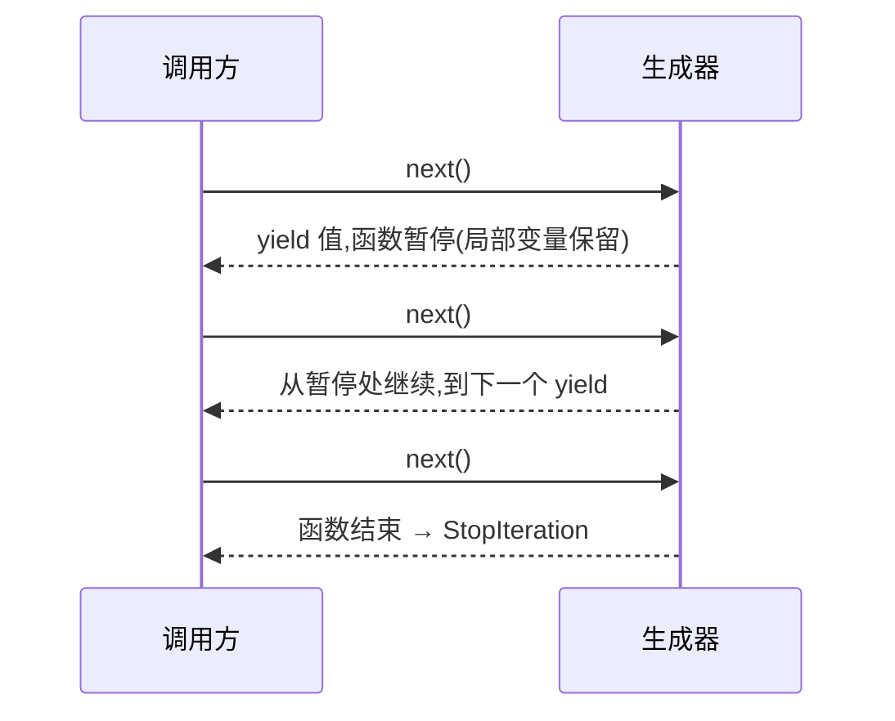

生成器是创建迭代器最省事的方式:函数体里出现 `yield`,它就不再是普通函数,而是一个"能暂停、能恢复"的生成器函数。调用它不执行函数体,只返回生成器对象。

## 暂停与恢复

```python
def countdown(n):
    while n > 0:
        yield n
        n -= 1

g = countdown(3)      # 此时函数体一行都没执行
next(g)               # 3,执行到第一个 yield 后暂停
next(g)               # 2
next(g)               # 1
next(g)               # StopIteration
```



暂停时,函数的局部变量、指令位置、异常处理状态都保存在生成器对象里。恢复时从 `yield` 表达式的下一行继续。这也是它与普通迭代器的差别:不需要手写状态机,解释器帮你保留执行上下文。

生成器对象本身就是迭代器:`iter(g) is g`,`__next__` 就是恢复执行。它只能走一次,耗尽后再 `next` 一直抛 StopIteration,不能重置。

## yield 是表达式,不只是语句

`yield` 有返回值,值来自 `send()`:

```python
def accumulator():
    total = 0
    while True:
        value = yield total       # 先把 total 送出去,暂停;send 的值成为 yield 的结果
        total += value

acc = accumulator()
next(acc)          # 0,启动到第一个 yield
acc.send(5)        # 5
acc.send(3)        # 8
```

第一次必须用 `next()`(或 `send(None)`)启动生成器,因为还没走到第一个 `yield`,无法接收值。`send(x)` 把 x 作为当前 `yield` 表达式的值,并继续执行到下一个 `yield`。

这就是最原始的协程模型:生成器既产出值,也接收值。`async/await` 在此基础上由事件循环驱动,第 10 章展开。

## throw 与 close

- `g.throw(Exc)`:在暂停处抛出异常,生成器可以捕获并处理;
- `g.close()`:在暂停处抛 GeneratorExit,生成器退出,`finally` 会被执行;
- 生成器被垃圾回收时也会收到 close 语义,因此 `finally` 里的资源清理是可靠的。

```python
def safe_reader(path):
    f = open(path, encoding="utf-8")
    try:
        for line in f:
            yield line.rstrip()
    finally:
        f.close()      # 提前 close() 或循环结束都会执行
```

把资源获取放在 `try` 之前、清理放在 `finally`,生成器中途被关闭也不会泄漏文件句柄。更规范的写法是用 `with`,下一篇的上下文管理器与生成器可以组合。

## return 与 StopIteration.value

生成器里的 `return value` 不产出值,而是结束迭代,并把 value 放进 StopIteration 的 value 属性:

```python
def find_first(xs, target):
    for i, x in enumerate(xs):
        if x == target:
            return i
    return -1

try:
    next(find_first([], "x"))
except StopIteration as e:
    print(e.value)      # -1
```

`for` 循环会吞掉 StopIteration,所以看不出返回值。需要读返回值时手动 `next` 并捕获异常,或者用 `yield from` 把子生成器的返回值接上来。

## yield from

`yield from iterable` 把另一个可迭代对象的值原样转发,并把它的 StopIteration.value 作为整个表达式的结果:

```python
def chain(*iterables):
    for it in iterables:
        yield from it

list(chain([1, 2], "ab", (3,)))     # [1, 2, 'a', 'b', 3]
```

它同时转发 `send`、`throw`、`close`,是写委托型生成器的标准方式,比自己写 `for x in it: yield x` 完整得多。

## 常见误用

- **把生成器当列表反复用**:第二次遍历什么都拿不到,需要重复使用时返回列表或重新调用生成器函数;
- **在生成器里修改外部集合**:惰性执行让修改时机难以追踪,调试成本高;
- **忘记启动**:直接 `send(non-None)` 会抛 TypeError,第一次必须 `next()`;
- **生成器函数里的 return 被当成产出**:`return` 的值不会出现在迭代结果里;
- **无限生成器直接 `list()`**:内存耗尽,必须配合 `islice`、`takewhile` 或显式中断。

## 小结

- `yield` 把函数变成生成器函数,调用得到生成器对象,执行在 `yield` 处暂停;
- 生成器保留局部状态,本身是迭代器,只能遍历一次;
- `yield` 是表达式,`send()` 向暂停处传值,`throw`/`close` 控制异常与退出;
- `return value` 进入 StopIteration.value,`yield from` 转发子迭代器;
- `finally` 保证生成器被关闭时完成清理。
