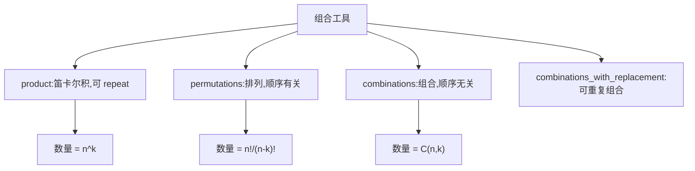

`itertools` 提供了一组惰性迭代器构建块,每个只做一件小事,但可以自由组合。它们不预先分配结果,适合处理大集合与流式数据。官方文档把工具分成三类:无限迭代器、有限迭代器、组合生成器。

## 无限迭代器

```python
from itertools import count, cycle, repeat

count(10, 2)                # 10, 12, 14, ... 无限
cycle("AB")                 # A, B, A, B, ... 无限
repeat("x", 3)              # x, x, x
```

这三个都不会自行结束,必须配合 `islice`、`zip`、显式 `break` 或条件消费,否则会耗尽内存或卡死。`count` 常用于给记录编号,`cycle` 用于轮询配色、轮转节点。

```python
from itertools import islice
list(islice(count(), 5))    # [0, 1, 2, 3, 4],截取前 5 个
```

## 有限迭代器:拼接、切片、过滤

```python
from itertools import chain, islice, takewhile, dropwhile, filterfalse, compress

chain([1, 2], [3], "ab")        # 1, 2, 3, 'a', 'b'
islice(range(100), 10, 20, 2)   # 10, 12, ..., 18;支持 start/stop/step
takewhile(lambda x: x < 3, [1, 2, 3, 1])   # 1, 2,遇到 3 停
dropwhile(lambda x: x < 3, [1, 2, 3, 1])   # 3, 1,跳过开头
filterfalse(lambda x: x > 0, [1, -1, 2])   # -1
compress("ABCD", [1, 0, 1, 0])             # 'A', 'C'
```

`takewhile` 与列表推导的过滤不同:它遇到第一个不满足的元素就停,后面的元素即使满足也不会再看。解析"文件头"这类连续段时正合适。`dropwhile` 则跳过开头满足条件的一段,常用于跳过注释与空行。

`chain` 拼接多个可迭代对象,`chain.from_iterable` 接受"可迭代对象的可迭代对象",处理动态列表时更省事:

```python
from itertools import chain
rows = [[1, 2], [3], [4, 5]]
list(chain.from_iterable(rows))     # [1, 2, 3, 4, 5]
```

## 组合生成器

```python
from itertools import product, permutations, combinations, combinations_with_replacement

list(product("AB", repeat=2))              # AA AB BA BB,笛卡尔积
list(permutations("ABC", 2))               # AB AC BA BC CA CB,有序
list(combinations("ABC", 2))               # AB AC BC,无序不重复
list(combinations_with_replacement("AB", 2))  # AA AB BB,可重复
```



组合结果的数量增长很快:`product` 是 n 的 k 次方,`permutations` 是阶乘级。对较大输入直接 `list()` 很容易撑爆内存,应确认规模或改用惰性消费。

## groupby:先排序再分组

`groupby` 按相邻元素的 key 分组,**不会**自动把相同 key 的元素聚到一起:

```python
from itertools import groupby

data = [("a", 1), ("b", 2), ("a", 3)]
[(k, list(g)) for k, g in groupby(data, key=lambda t: t[0])]
# [('a', [(a, 1)]), ('b', [(b, 2)]), ('a', [(a, 3)])]  ← 两组 a

data.sort(key=lambda t: t[0])       # 先排序
[(k, list(g)) for k, g in groupby(data, key=lambda t: t[0])]
# [('a', [(a, 1), (a, 3)]), ('b', [(b, 2)])]
```

另外,`groupby` 返回的分组迭代器共享底层游标:一旦处理了下一组,上一组的数据就失效了。需要保留时,在处理当前组时立刻 `list(g)`。

## tee 与 pairwise

`tee` 把一个可迭代对象拆成多个,各自独立前进:

```python
from itertools import tee

a, b = tee(open("data.txt", encoding="utf-8"), 2)
first = next(a)
total = sum(1 for _ in b)
```

`tee` 内部会缓存尚未被其他分支消费的元素,拆得越多、进度差越大,内存占用越高。它适合"同一份流要做两种处理",不适合替代把数据存下来。

3.10+ 提供 `pairwise`,产出一对相邻元素,做差分与相邻比较很方便:

```python
from itertools import pairwise
list(pairwise([1, 4, 9, 16]))      # [(1, 4), (4, 9), (9, 16)]
```

旧版本可以用官方 recipes 里的等价实现:`zip(xs, xs[1:])`(仅序列)或 `tee` + `zip`(任意可迭代对象)。

## 使用原则

- 先看标准库有没有现成工具,别急着写循环;
- 无限迭代器必须配 `islice` 或终止条件;
- 组合类工具先估算数量级,避免阶乘爆炸;
- `groupby` 之前先按同一 key 排序,并立即消费分组;
- 需要多次遍历同一份流,优先物化,`tee` 只用于短距离分叉。

## 小结

- 无限迭代器 `count`/`cycle`/`repeat` 必须截断或终止;
- `islice`、`takewhile`、`dropwhile` 分别按位置与条件截取;
- `product`/`permutations`/`combinations` 生成组合,结果规模增长极快;
- `groupby` 只合并相邻元素,分组前必须排序,分组结果要及时消费;
- `pairwise` 处理相邻对,`tee` 用于有限分叉。
