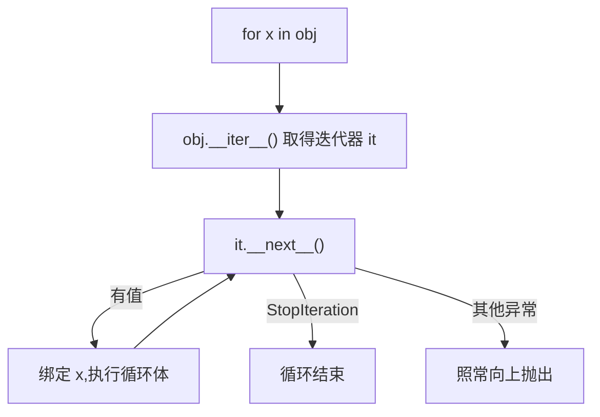

`for` 能遍历列表、字典、文件、生成器,靠的是一套统一的约定,而不是针对每种类型写特例。这套约定叫迭代协议,只有两个方法:`__iter__` 与 `__next__`。

## 协议的执行过程



`for` 先调用 `iter(obj)` 拿到迭代器,然后反复 `next(it)`,直到捕获 StopIteration。`list(obj)`、`tuple(obj)`、`sum(obj)`、`in` 判断、解包、`zip` 全都走同一套流程。

## 可迭代对象与迭代器

这两个概念经常混用,实际分工不同:

| 概念 | 要求 | 例子 |
| --- | --- | --- |
| 可迭代对象 | 实现 `__iter__`,返回一个迭代器 | list、dict、str、文件对象 |
| 迭代器 | 实现 `__next__`,且 `__iter__` 返回自身 | 生成器、`iter(list)` 的返回值 |

```python
nums = [1, 2, 3]
it = iter(nums)          # 列表是可迭代对象
next(it)                 # 1
next(it)                 # 2
iter(it) is it           # True,迭代器的 __iter__ 返回自身
```

关键区别:**可迭代对象本身不记遍历位置**,每次 `iter()` 都得到新的迭代器;迭代器记位置,耗尽后不能重置。所以列表可以被遍历多次,而迭代器只能遍历一次:

```python
it = iter([1, 2])
list(it)      # [1, 2]
list(it)      # [],已经耗尽
```

需要多次遍历时,传可迭代对象而不是迭代器;函数接收"可迭代"参数却要遍历两遍时,先在内部 `list()` 物化一份。

## 自定义可迭代对象

只要实现 `__iter__`,自己的类就能进 `for`:

```python
class Countdown:
    def __init__(self, start):
        self.start = start

    def __iter__(self):
        n = self.start
        while n > 0:
            yield n
            n -= 1

for x in Countdown(3):
    print(x)        # 3, 2, 1
```

这里 `__iter__` 是生成器函数,每次调用返回一个新的生成器对象,因此 `Countdown` 可以被反复遍历。把状态放在实例上、`__iter__` 返回 `self`,它就变成了一次性迭代器,两种设计各有用途。

## 手写迭代器

不用生成器时,迭代器要自己维护状态:

```python
class CountdownIterator:
    def __init__(self, start):
        self.current = start

    def __iter__(self):
        return self

    def __next__(self):
        if self.current <= 0:
            raise StopIteration
        self.current -= 1
        return self.current + 1
```

`__next__` 耗尽后必须抛 StopIteration,而且要保持在耗尽状态:再次调用仍抛异常,不能重新开始。忘记这一点会让 `list()` 之类无限循环。

## __getitem__ 的旧式迭代

没有 `__iter__`、但有 `__getitem__` 的对象,`for` 会退回到下标迭代:从 0 开始,直到 IndexError:

```python
class Seq:
    def __getitem__(self, i):
        if i >= 3:
            raise IndexError
        return i * 10

list(Seq())      # [0, 10, 20]
```

这是历史兼容行为。新代码应显式实现 `__iter__`,否则 `__getitem__` 的边界处理稍有偏差,就可能迭代出错误结果。

## 迭代器与容器

- 容器(list、dict、set)负责存储,是可迭代对象,通常可多次遍历;
- 迭代器负责"走到哪了",一次性;
- 生成器是创建迭代器最省事的方式,下一篇展开;
- `iter(callable, sentinel)` 可以把"反复调用直到某个返回值"包装成迭代器,读文件块、读传感器数据时有用。

区分这两类对象,才能解释"为什么 `map` 的结果 `list()` 一次就空了",以及"为什么函数返回生成器后第二次遍历没有输出"。

## 小结

- `for` 依赖 `iter()` + `next()` + StopIteration 这套协议;
- 可迭代对象每次 `iter()` 返回新迭代器,迭代器记录位置且只能走一次;
- 迭代器的 `__iter__` 必须返回自身,耗尽后持续抛 StopIteration;
- 生成器函数让 `__iter__` 的实现最简;
- 只有 `__getitem__` 的对象会走旧式下标迭代,新代码应显式实现 `__iter__`。
