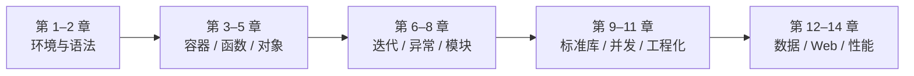

这份 Python 知识库共 14 章。它不按"字典式罗列 API"组织,而按**一条能跑通的主线**推进:先会写,再写对,再写好,最后写快。这一篇说明结构与读法。

## 章节地图

- **第 1-2 章 环境与语法**:装环境、名字绑定、数字字符串、运算、分支循环、函数入门。目标:写出能跑的小程序;
- **第 3-5 章 容器、函数、对象**:列表/字典/集合与拷贝、参数体系与闭包装饰器、类与数据模型。目标:组织中等规模代码;
- **第 6-8 章 迭代、异常、模块**:迭代协议与生成器、异常与 with、import 与虚拟环境、类型提示。目标:理解 Python 的"协议化"设计;
- **第 9-11 章 标准库、并发、工程化**:常用库、GIL 与 asyncio、pyproject/pytest/ruff。目标:交付可维护的项目;
- **第 12-14 章 数据、Web、性能**:numpy/pandas、HTTP 与 FastAPI、测量与优化。目标:按方向深入。

## 每篇的四件

- **思维导图**:本篇骨架,先看图再读文,读完后用它自测;
- **正文**:概念 + 可运行示例 + 易错点。示例都假设 3.12+,可直接复制运行;
- **术语**:正文首次出现的关键名词带下划线,悬停看一句解释,点进术语表看形式化定义与常见误读;
- **来源**:页脚列出官方文档/PEP 链接,存疑时以官方为准。

## 读法建议

1. **边读边跑**:每段示例在 REPL 或脚本里执行一次,改一个参数看结果变化。只读不跑,迭代器与拷贝这类概念几乎必误解;
2. **先主线后支线**:第 1-8 章是主线,按顺序读;第 12-14 章按方向选(做数据读 12,做接口读 13,调优读 14);
3. **易错点优先**:每篇的"注意"与术语表的"常见误读"是前人踩过的坑,比正文更值得记;
4. **用项目串章**:学完第 8 章做一个命令行小工具(文件整理/记账),学完第 13 章把它包成 HTTP 接口。项目会把散点连成线;
5. **对照官方**:本库是导读与易错点集合,API 细节以 docs.python.org 为准,页脚来源即入口。

## 与 Java 线的关系

若你已读 Java 线:第 2 章的名字绑定对应 Java 的引用与值;第 5 章数据模型对应 Java 的 equals/hashCode 契约;第 6 章迭代协议对应 Java 的 Iterable/Iterator;第 10 章 GIL 对应 Java 的线程模型差异。对照读能更快建立映射,但注意两者语义并不总是一一对应(如 Python 没有编译期类型检查)。

## 小结

- 14 章按"会写→写对→写好→写快"推进,1-8 主线、12-14 按方向;
- 每篇四件:导图/正文/术语/来源;
- 边读边跑、易错点优先、用项目串章;
- API 细节以官方文档为准;
- 有 Java 基础可对照读,但语义映射不总成立。

从第 2 章开始动手。
