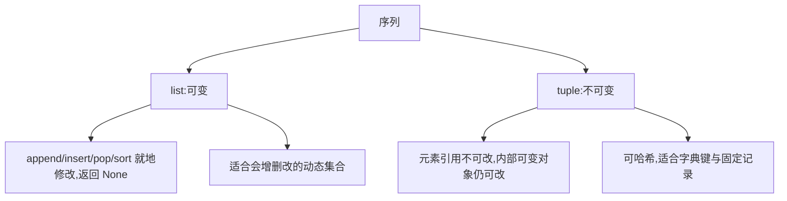

列表与元组都是**序列**:有序、可索引、可切片、可迭代。差别只有一条核心:**list 可变,tuple 不可变**。这条差别决定了它们各自的用途与陷阱。

## 列表:可变序列

```python
xs = [3, 1, 2]
xs.append(4)        # 尾部加,O(1) 摊还
xs.insert(0, 0)     # 头部插,O(n)
xs.extend([5, 6])   # 批量加,等价 xs += [5, 6]
xs.remove(1)        # 按值删第一个
xs.pop()            # 弹出尾部,O(1);pop(0) 为 O(n)
xs.sort()           # 就地排序,返回 None
xs.reverse()        # 就地反转
```

注意 sort/reverse/append 等就地方法**返回 None**。`ys = xs.sort()` 会让 ys 为 None,这是高频错误。要新列表用内置 `sorted(xs)` / `reversed(xs)`(后者返回迭代器)。

排序键:`xs.sort(key=lambda p: p.age, reverse=True)`;key 函数每元素调用一次,比 cmp 旧模式高效。稳定排序:相等键保持原相对顺序。

栈与队列:列表作栈 append/pop 天然合适;作队列头部 pop(0) 是 O(n),应改用 collections.deque(第 9 章)。

## 元组:不可变序列

```python
t = (1, "a", [2])
t[0] = 9          # TypeError
t[2].append(3)    # 合法!元组只保证引用不变,列表自身可变
```

单元素元组必须带逗号:`(1,)`,否则 `(1)` 只是整数 1 的括号。

用途:

- **多值返回与解包**:`return q, r`、`a, b = b, a`;
- **字典键/集合元素**:不可变才可哈希(第 3.2 篇);
- **语义上的"记录"**:固定字段的一组值,如坐标 (x, y);字段需要名字时用 namedtuple/dataclass(第 5 章);
- **函数默认参数/常量集合**:不可变保证不被意外修改。

## 共同的序列操作

索引(负索引)、切片(含头不含尾)、`in`、`len`、`+` 拼接、`*` 重复、解包、enumerate/zip 遍历。切片返回**新序列**(浅拷贝,第 3.5 篇)。

注意:`xs * 3` 对嵌套可变对象是重复引用而非深复制:`[[]] * 3` 得到三个指向同一列表的引用,改一个全变。

## 选型



| 需求 | 选择 |
| --- | --- |
| 会增删改的集合 | list |
| 固定记录/多值返回/字典键 | tuple |
| 带名字的固定记录 | namedtuple / dataclass |
| 两端高效进出 | deque |

## 小结

- list 可变:append/extend/pop/sort 就地,返回 None;要新列表用 sorted;
- sort 稳定,key 每元素一次;队列用 deque 而非 list.pop(0);
- tuple 不可变:单元素带逗号;内部引用的可变对象仍可改;
- tuple 用于多值返回、字典键、固定记录;
- 切片得新序列(浅拷贝);* 重复嵌套可变对象是共享引用。

下一篇讲字典与集合:哈希容器的键要求与性能。
