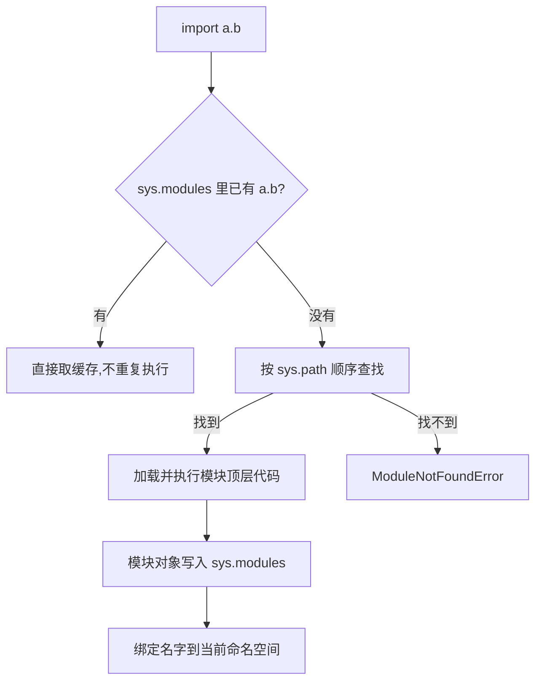

`import` 不是"读一个文件"这么简单。它要找到模块、执行模块顶层代码、把结果缓存起来,并把名字绑定到当前命名空间。理解这三步,循环导入、模块重复执行、路径找不到这些问题才有解释。

## 导入的三步



- **查找**:按 `sys.path` 的顺序找匹配的模块或包;
- **执行**:第一次导入时执行模块顶层代码,函数体与类体不执行;
- **缓存**:执行结果放进 `sys.modules`,之后再导入直接复用。

"模块只执行一次"来自缓存,不是语言刻意去重。测试里需要重新加载模块时用 `importlib.reload`,而不是删掉再 import。

## sys.path 的组成

```python
import sys
for p in sys.path:
    print(p)
```

通常依次是:

1. 脚本所在目录(或空字符串,表示当前工作目录);
2. `PYTHONPATH` 环境变量里的目录;
3. 标准库目录;
4. `site-packages`,第三方包安装位置。

先找到的优先。这也意味着**你自己的模块名不要与标准库或第三方包重名**:项目里放一个 `random.py`,同目录脚本 `import random` 会导入你的文件,标准库被遮住。这类问题报错信息往往奇怪,排查时先看 `sys.path` 与模块名。

`sys.path` 是运行时列表,可以追加目录,但只建议在脚本入口临时使用;库代码不应修改全局搜索路径。

## import 语句的几种形式

```python
import os                      # 绑定模块名 os
import numpy as np             # 绑定别名 np
from pathlib import Path       # 只绑定 Path,不是绑定 pathlib
from os.path import join as j  # 重命名
from . import sibling          # 包内相对导入(第 2 篇)
```

- `import a.b`:绑定的是顶层名 `a`,`a.b` 通过属性访问;`__import__("a.b")` 默认返回 a,这也是 `importlib.import_module` 更常用的原因;
- `from a import name`:先导入 a,再从 a 的命名空间取 name;name 不存在时 ImportError;
- `from a import *`:导入 `__all__` 声明的名字(没有 `__all__` 时导入不以下划线开头的名字),在业务代码中避免使用,它让名字来源不可追踪。

`import` 可以放在函数内,起到延迟导入与打破循环的作用,代价是每次调用都要查缓存、且不利于静态分析。常规依赖放模块顶部。

## 循环导入

两个模块互相 import 时,第二个模块执行到一半就可能被对方引用:

```python
# a.py
from b import b_func

def a_func(): ...

# b.py
from a import a_func      # 此时 a 还没执行完,a_func 尚未定义
```

```text
ImportError: cannot import name 'a_func' from partially initialized module 'a'
```

成因是模块对象已经放进 `sys.modules`,但顶层代码还没跑完,被引用的名字还不存在。常见解法:

- **调整依赖方向**:抽出公共部分到第三个模块,让依赖成为单向;
- **把 import 移到函数内**:调用时才解析,避免导入阶段互相等待;
- **只 import 模块,不 import 名字**:`import a` 后用 `a.a_func()`,导入阶段不访问尚未定义的名字;
- **重构职责**:互相依赖通常说明两个模块耦合过紧。

## 动态导入

模块名在运行时才确定时(插件、配置驱动的处理器),用 `importlib`:

```python
import importlib

module = importlib.import_module("plugins." + name)   # 返回模块对象
handler = getattr(module, "handle")
handler(payload)
```

`import_module` 接受字符串,返回模块对象,支持包内相对导入(传 `package=` 参数)。不要用 `eval`、`exec` 拼接 import 语句,那既不安全也无法被工具分析。

插件系统里通常配合白名单与接口约定:配置里只允许出现已注册的名字,导入后检查是否实现了预期方法,不要直接执行用户提供的任意模块名。

## 小结

- import 分查找、执行、缓存三步,缓存导致模块只执行一次;
- 查找按 `sys.path` 顺序,项目模块不要与标准库同名;
- `from x import y` 先导入 x 再取 y,`import *` 不要用于业务代码;
- 循环导入源于导入期互相取名字,拆依赖、延迟导入或只导入模块可解;
- 运行时确定的模块名用 `importlib.import_module`,不要拼 import 语句。
