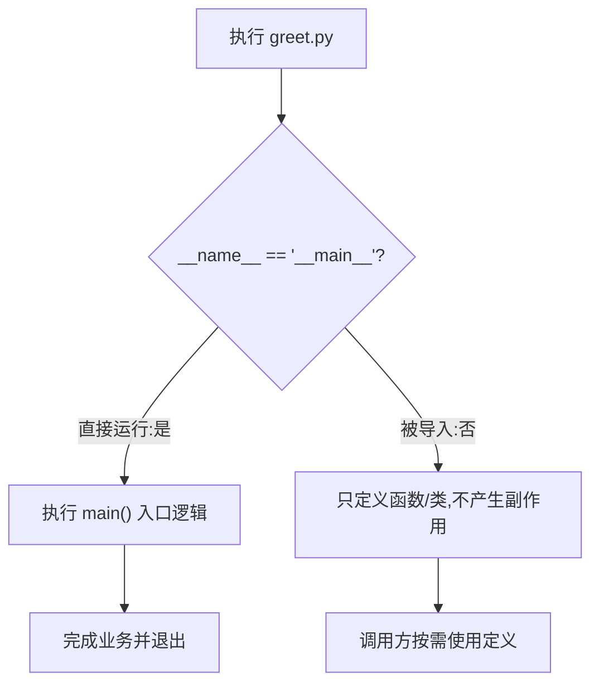

同一个 `.py` 文件有两种身份:被别的模块导入时,它是模块;被 `python file.py` 直接运行时,它是主程序。`__name__` 就是区分这两种身份的标志。

## __name__ 的两种取值

```python
# greet.py
print(f"__name__ = {__name__}")
```

```text
$ python greet.py
__name__ = __main__

$ python -c "import greet"
__name__ = greet
```

- 直接运行:`__name__` 是 `"__main__"`;
- 被导入:`__name__` 是模块名(包内是完整点号名,如 `shop.orders.service`)。

`__main__` 不是文件名,而是"当前主程序"这个特殊命名空间的名字。Python 把入口模块以这个名字注册进 `sys.modules`,所以 `__main__` 也可能被其他模块 import,得到同一份模块对象。

## if __name__ == "__main__" 防住了什么

```python
def parse(text):
    ...

def main():
    data = open("input.txt", encoding="utf-8").read()
    print(parse(data))

if __name__ == "__main__":
    main()
```

没有这层判断时,任何模块 `import greet` 都会在导入阶段执行 `main()`:读文件、打印输出、甚至启动服务。导入应当是"定义名字"的动作,不应附带副作用。有了判断:

- 直接运行:条件为真,执行入口;
- 被导入:条件为假,只定义函数与类。



## 标准入口写法

把入口收进 `main()` 函数,并让模块顶层只保留定义:

```python
import sys

def main(argv=None):
    args = parse_args(argv if argv is not None else sys.argv[1:])
    run(args)
    return 0

if __name__ == "__main__":
    raise SystemExit(main())
```

- `main()` 接收参数、返回退出码,便于单元测试直接调用,不必起子进程;
- `raise SystemExit(main())` 把返回值作为进程退出码:0 表示成功,非 0 表示失败;
- `sys.argv[0]` 是脚本名,业务参数从 `sys.argv[1:]` 开始;
- 需要命令行解析时用 `argparse`(第 9 章),不要在 `main` 里手写字符串切割。

`SystemExit` 是 BaseException 的直接子类,不会被 `except Exception` 误接;它触发解释器正常退出,`finally` 仍会执行。

## 命令行入口的三种形态

| 形态 | 命令 | 说明 |
| --- | --- | --- |
| 直接运行文件 | `python tool.py` | 脚本目录进入 `sys.path`,适用于单文件工具 |
| 以模块运行 | `python -m shop.tool` | 包结构完整,相对导入可用,推荐 |
| 安装后的命令 | `mytool` | 由 `pyproject.toml` 的 `[project.scripts]` 生成,见第 11 章 |

`python -m` 与直接运行的区别不只是相对导入:前者把当前目录加入 `sys.path`,后者把脚本所在目录加入。项目的入口应统一用 `-m` 或安装后的命令,避免"本地能跑、部署报错"。

## 常见错误

- **在模块顶层放副作用**:连接数据库、发请求、启动线程,导入即触发,测试无法隔离;
- **把入口逻辑写成全局变量**:调试与复用都困难,收进 `main()` 更清晰;
- **入口里 `sys.exit()` 中途退出**:深层的 `sys.exit` 会绕过调用方的清理逻辑,只应在最外层使用;
- **用 `__name__ == "__main__"` 判断包内相对导入**:它只解决"是否执行入口",不解决"包上下文是否存在";
- **让 `__main__.py` 直接承担全部业务**:入口只做参数与调度,业务放在可测试的函数里。

## 小结

- `__name__` 在直接运行时是 `"__main__"`,导入时是模块名;
- `if __name__ == "__main__"` 防止导入时执行入口逻辑;
- 入口收进 `main()`,用 `raise SystemExit(main())` 返回退出码;
- 包内程序优先 `python -m`,安装后的命令由打包配置生成;
- 模块顶层只放定义,副作用留给显式调用的入口。
