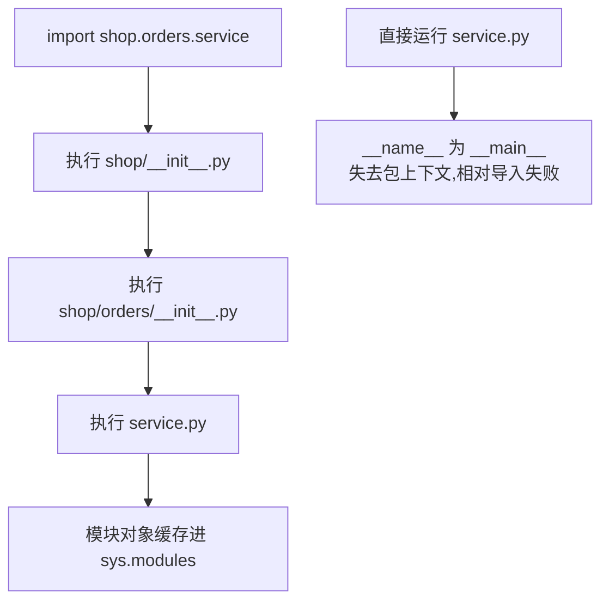

包把模块按目录组织起来,并用点号表示层级。`shop.orders.service` 表示 `shop/orders/service.py`,这层映射由导入系统完成。包里的 `__init__.py` 不只是"标记目录",它还是包的入口。

## 目录与点号

```text
shop/
├── __init__.py
├── models.py            # shop.models
├── orders/
│   ├── __init__.py
│   └── service.py       # shop.orders.service
└── utils.py             # shop.utils
```

导入时逐层执行:`import shop.orders.service` 会先执行 `shop/__init__.py`,再执行 `shop/orders/__init__.py`,最后执行 `service.py`。任何一层的顶层代码报错,整个导入都会失败。

## __init__.py 的职责



常见有三类:

```python
# shop/__init__.py
__version__ = "1.2.0"                     # 1. 包级元数据

from .models import Order, Product        # 2. 把子模块的公共接口提到包一层
__all__ = ["Order", "Product", "connect"] # 3. 声明 from shop import * 的边界
```

- **初始化**:建立包级常量、注册子模块、配置日志命名空间;
- **导出 API**:让调用方写 `from shop import Order`,而不必记住 `shop.models.Order`;
- **控制边界**:`__all__` 同时影响 `import *` 与文档工具,明确哪些名字是公开的。

`__init__.py` 应保持轻量。把大量初始化逻辑(连数据库、读配置、启动线程)放进去,会让"只想导入一个小工具"的调用方被迫承担全部副作用,测试也更难隔离。

## 相对导入

包内模块互相引用时用点号表示相对位置:

```python
# shop/orders/service.py
from . import repo            # 同级模块 shop.orders.repo
from ..models import Order    # 上一级包 shop.models
from .utils import money      # 同级 utils
```

- 一个点表示当前包;
- 两个点表示上一级包,以此类推;
- 只能在包内使用,顶层模块没有"当前包",相对导入会报 ImportError。

**为什么直接运行文件会失败**:

```text
python shop/orders/service.py
ImportError: attempted relative import with no known parent package
```

直接运行脚本时,该文件的 `__name__` 是 `__main__`,不属于任何包,相对导入失去参照。正确入口有两种:

- 以模块方式运行:`python -m shop.orders.service`;
- 在项目根目录写一个入口脚本,导入包内的模块。

用 `-m` 时,当前目录会进入 `sys.path`,包结构被正确识别。

## 命名空间包

PEP 420 允许没有 `__init__.py` 的包。目录仍然可以是包,导入系统把沿途找到的同名目录合并成一个命名空间:

```text
libA/company/tools/a.py
libB/company/tools/b.py
```

把 libA 与 libB 都加入 `sys.path` 后,`company.tools.a` 与 `company.tools.b` 都能导入。适合多个发行版共享一个顶层命名空间的场景(大型组织的插件生态)。

代价是:命名空间包没有 `__init__.py` 可做初始化,包的边界也更隐式。普通应用不需要这个特性,老老实实加 `__init__.py`,行为更可预测。

## 让包可执行:__main__.py

```text
shop/
└── __main__.py
```

有了它,`python -m shop` 会执行 `__main__.py`。常用于给包提供一个命令行入口:

```python
# shop/__main__.py
from .cli import main

if __name__ == "__main__":
    raise SystemExit(main())
```

这篇只讲"包如何被当成程序运行";下一节系统讲 `__name__` 与入口的区别。

## 常见结构问题

- **包名与标准库重名**:如 `email/`、`json/`,会把标准库遮住;
- **循环相对导入**:`a` 导入 `b`,`b` 又导入 `a`,与模块级循环导入同源,拆依赖解决;
- **在 `__init__.py` 里导入所有子模块**:导入任意一个 API 都会加载整包,启动变慢;
- **把可变全局状态放在 `__init__.py`**:测试之间互相污染;
- **测试目录没有 `__init__.py` 却用相对导入**:测试文件通常按脚本或 pytest 方式加载,相对导入可能失效,改用项目根目录的绝对导入或调整测试配置。

## 小结

- 包是带层级的模块目录,导入时逐层执行 `__init__.py`;
- `__init__.py` 负责初始化、导出公共接口与控制 `__all__` 边界,应保持轻量;
- 相对导入用点号,只能在包内使用,直接运行文件会失去包上下文;
- 命名空间包允许无 `__init__.py`,适合共享顶层命名空间;
- `__main__.py` 让包支持 `python -m 包名`。
