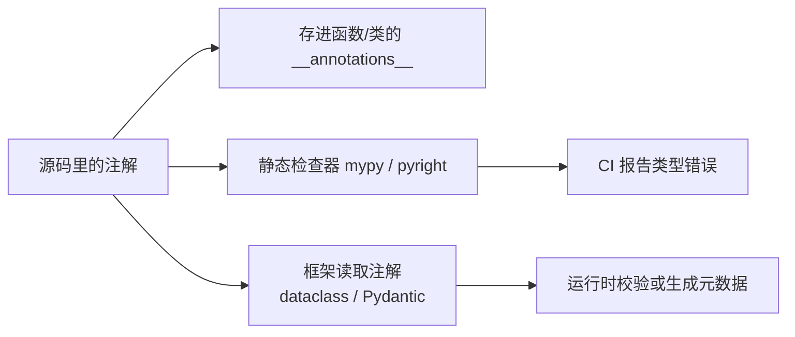

类型注解写在冒号后面,解释器不会据此检查实参类型,但会把它存进 `__annotations__`,供静态检查器与框架读取。类型提示的价值在于"提前发现调用错误、给 IDE 补全依据、给框架提供元数据",而不是运行时校验。

## 注解只是元数据

```python
def add(a: int, b: int) -> int:
    return a + b

add("x", 1)        # 运行时不报错,静态检查器会标红
add.__annotations__
# {'a': <class 'int'>, 'b': <class 'int'>, 'return': <class 'int'>}
```

要运行时校验,得靠 `isinstance` 手写、dataclass 的 `__post_init__`,或 Pydantic 这类在解析入口做验证的库。三者职责不同:注解描述"应该是什么",检查器在编译前核对,框架在边界处校验。

## 常用写法



```python
from typing import Optional

count: int = 0
name: str | None = None            # 3.10+ 的联合写法
path: list[str] = []               # 内置泛型,3.9+
table: dict[str, int] = {}
pair: tuple[int, str] = (1, "a")
callback: Callable[[int], str] = str
config: dict[str, object] = {}
```

- 内置容器可以直接下标:`list[int]`、`dict[str, int]`,不再需要 `typing.List`;
- 联合类型用 `X | None`,旧版本写 `Optional[X]`;
- `Any` 表示"不检查",应尽量少用,它会让错误漏过去;
- `object` 表示"任意对象但只能做所有对象都支持的操作",比 `Any` 更安全;
- `Sequence`、`Iterable`、`Mapping` 描述能力而非具体类型,是最推荐的参数注解。

```python
from collections.abc import Iterable, Mapping

def total(values: Iterable[float]) -> float:
    return sum(values)

def lookup(table: Mapping[str, int], key: str) -> int:
    return table[key]
```

参数尽量用抽象类型,调用方传列表、元组、生成器都能通过;返回值再写具体类型。

## 泛型与 TypeVar

```python
from typing import TypeVar

T = TypeVar("T")

def first(items: list[T]) -> T:
    return items[0]
```

`T` 把参数与返回值的类型关联起来:`first([1, 2])` 推出 `int`,而不是 `Any`。3.12 起可以用新语法:

```python
def first[T](items: list[T]) -> T:
    return items[0]
```

自定义泛型容器时继承 `Generic[T]`,或者在类定义旁声明 `class Box(Generic[T])`。泛型主要用于"输入输出类型相关"的场景,没这个需求就不要引入 `TypeVar`。

## Protocol:结构化类型

```python
from typing import Protocol

class Reader(Protocol):
    def read(self, n: int = -1) -> str: ...

def read_all(src: Reader) -> str:
    return src.read()

read_all(open("a.txt"))           # 文件对象满足协议,无需显式继承
```

`Protocol` 只看"有没有这些方法",不要求继承关系,对应 Python 的鸭子类型。它与抽象基类(ABC)的分工:

| | ABC | Protocol |
| --- | --- | --- |
| 关系 | 显式继承 | 结构匹配 |
| 运行时 | 可用 isinstance 检查 | 需 `runtime_checkable` 才能 isinstance |
| 适用 | 框架约束实现 | 描述第三方对象的能力 |

`runtime_checkable` 的 isinstance 只检查方法是否存在,不检查签名,误用会产生假阳性,常规用法是只给静态检查器看。

## TypedDict:描述字典形状

```python
from typing import TypedDict

class Movie(TypedDict):
    title: str
    year: int
    rating: float

m: Movie = {"title": "Alien", "year": 1979, "rating": 8.5}
```

TypedDict 不生成运行时类,字典还是普通 dict,只是告诉检查器"这些键是什么类型"。它适合 JSON、配置、函数返回的固定结构。可选的键用 `NotRequired`,3.11 起在 `typing` 里提供。

需要运行时校验与默认值时用 dataclass 或 Pydantic 模型;只需要标注外部数据形状时用 TypedDict,不要为它建一个真正的类。

## 静态检查工具

```bash
mypy src
pyright src
ruff check src
```

- **mypy**:最老牌,插件生态丰富,可在 `pyproject.toml` 里配置严格度;
- **pyright**:微软维护,速度快,VS Code 内置;
- **ruff**:以 lint 为主,也带一部分类型相关规则,可与前两者并行;
- 三者都不在运行时执行,CI 里跑,编辑器里提示。

渐进式收紧的常用路径:

1. 先只检查新增代码,老代码用 `# type: ignore` 或排除目录;
2. 打开 `disallow_untyped_defs`,补齐函数签名;
3. 再打开 `strict`,逐个处理 `Any` 与联合类型分支;
4. 保持 CI 中零错误,否则类型注解会迅速腐化。

## 循环引用与前向注解

类还没定义就要引用它时,注解可以用字符串:

```python
class Node:
    def __init__(self, next: "Node | None" = None):
        ...
```

或者在文件头写 `from __future__ import annotations`,所有注解延迟求值,等价于全部加引号。这在 3.11 之前很常用;3.13 起注解默认延迟求值,新项目按目标版本决定是否还需要这行。

延迟求值会影响运行时读取注解的框架(如 `dataclasses`、Pydantic、`typing.get_type_hints`),它们需要解析字符串形式的注解。排查"框架拿不到类型"时,先看是否开启了延迟求值。

## 小结

- 注解是元数据,运行时不校验,价值在静态检查与框架读取;
- 容器用内置泛型,联合用 `| None`,参数优先抽象类型;
- `TypeVar` 关联输入输出,`Protocol` 描述结构,`TypedDict` 描述字典;
- mypy / pyright 在 CI 中执行,严格度渐进收紧;
- 前向引用用字符串注解或延迟求值,注意框架对注解的解析方式。
