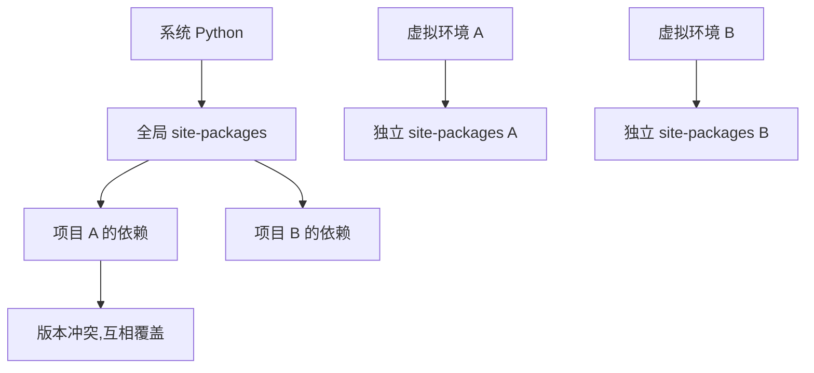

Python 的第三方包默认装进解释器自己的 `site-packages`,所有项目共享。项目 A 要 `requests 2.28`,项目 B 要 `requests 3.x`,全局环境无法同时满足。虚拟环境给每个项目一份独立的解释器与包目录,解决的就是这个冲突。

## 为什么需要独立环境



除了版本冲突,虚拟环境还带来两个好处:

- **可复现**:依赖清单锁定后,换机器能装出同样的环境;
- **可删除**:环境坏了直接删目录重建,不影响系统 Python。

原则是:每个项目一个虚拟环境,不往全局 `site-packages` 装业务依赖。

## 创建与激活

```bash
# 在项目根目录创建
python -m venv .venv

# Windows(PowerShell)
.venv\Scripts\Activate.ps1

# Windows(cmd)
.venv\Scripts\activate.bat

# macOS / Linux
source .venv/bin/activate
```

激活后,`python`、`pip` 指向环境内的可执行文件,命令行提示符前会出现 `(.venv)`。`deactivate` 退出。

```text
.venv/
├── Scripts/  (Windows)               或 bin/  (POSIX)
│   ├── python.exe
│   ├── pip.exe
│   └── activate 系列脚本
├── Lib/site-packages/                (Windows) 或 lib/python3.x/site-packages/
└── pyvenv.cfg
```

虚拟环境不复制解释器二进制,`pyvenv.cfg` 记录基础解释器路径,启动时按配置决定 `sys.prefix`。这也意味着删掉基础解释器后,环境会失效。

不激活也可以直接用环境里的解释器:

```bash
.venv\Scripts\python -m pip install requests
```

CI、定时任务、编辑器配置里通常这么写,不依赖 shell 的激活状态。

## pip 的日常操作

```bash
pip install requests                  # 安装
pip install "requests>=2.31,<3"       # 版本范围
pip install -r requirements.txt       # 按清单安装
pip show requests                     # 查看元数据与位置
pip list                              # 已安装包
pip uninstall requests                # 卸载
pip freeze > requirements.txt         # 导出当前锁定版本
```

`pip show` 输出里的 `Location` 能确认包装进了哪个环境,排查"明明装了却 import 不到"时先看这里。

## requirements 的两种粒度

```text
# requirements.txt:直接依赖,写范围
requests>=2.31
fastapi~=0.115
```

```text
# requirements.lock:完整锁定,写精确版本与哈希(由工具生成)
requests==2.32.3
certifi==2026.9.9
...
```

手写清单只列直接依赖,允许补丁版本浮动;需要严格复现时,用 `pip freeze` 或 `pip-tools`/`uv` 生成锁文件。把锁文件提交到仓库,部署时 `pip install -r` 安装同一套版本。

不要把 `pip freeze` 的完整输出当人工维护的依赖声明:它包含所有间接依赖,很难阅读,也无法表达"允许升级到哪个范围"。两者分工:声明用范围,部署用锁定。

## 常见问题

- **在错误的解释器里安装**:`pip` 是全局的,装完项目里还是 import 不到。先 `python -m pip --version` 确认路径是否在 `.venv` 内;
- **把 `.venv` 提交进仓库**:环境目录体积大且与平台绑定,`.gitignore` 里加 `.venv/`;
- **一次装多个版本的同一包**:先 `pip uninstall` 再装,或直接用 `pip install 包==版本` 覆盖,必要时看 `pip check`;
- **依赖冲突报错**:`pip check` 列出不满足的约束,按提示统一版本范围,不要逐个强行安装;
- **生产环境用 `--user` 安装**:路径依赖用户目录,服务账号与交互账号往往不一致,容器与服务器一律用虚拟环境。

## 与现代工具的关系

`venv` + `pip` 是标准库自带的基线方案,任何环境都有。`uv`、`poetry`、`pdm` 在这一层之上提供锁定、解析加速与项目管理,底层仍然创建虚拟环境或独立环境目录。

第 11 章会讲 `uv` 的用法;在此之前,先把 `venv` 与 `pip` 的边界弄清楚:虚拟环境负责隔离,`pip` 负责安装,锁文件负责复现。换了工具,这三件事的职责不变。

## 小结

- 每个项目一个虚拟环境,避免全局依赖冲突;
- `python -m venv .venv` 创建,按平台激活,`deactivate` 退出;
- `pip install -r` 安装,`pip show` 确认位置,`pip freeze` 导出锁定;
- 依赖声明写范围,部署锁定写精确版本;
- `.venv` 不进仓库;新版工具仍建立在虚拟环境之上。
