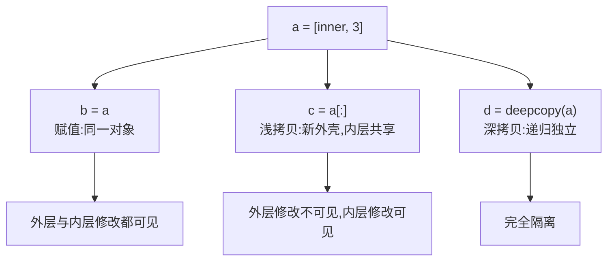

"我改了一个列表,另一个怎么也变了?"——这类事故的根源都是**别名与拷贝层级**没分清。这一篇把赋值、浅拷贝、深拷贝三层语义一次讲透。

## 三层语义

```python
import copy
inner = [1, 2]
a = [inner, 3]

b = a                # 赋值:同一对象,两个名字
c = a[:]             # 浅拷贝:新外壳,内层共享
d = copy.deepcopy(a) # 深拷贝:递归独立

inner.append(9)
# b、c 都看见 [1,2,9];d 不变
a.append(4)
# b 看见(同一对象);c、d 不变(外壳独立)
```

- **赋值**:不产生新对象,只增加别名。任何修改所有名字可见;
- **浅拷贝**:新建外层容器,把原对象各项的**引用**填进去。外层增删互不影响,内层共享对象修改双方可见;
- **深拷贝**:递归复制对象及其包含的全部对象,完全独立。

## 哪些操作是浅拷贝



list(x)、x[:]、x.copy()、dict(x)、d.copy()、set(x)、copy.copy(x) —— 全是浅拷贝。切片、推导式构造的新容器 likewise 只复制一层引用。

注意:`[[]] * 3` 不是拷贝而是**重复同一引用**,三个位置指向同一个列表;`[[] for _ in range(3)]` 才是三个独立列表。这是嵌套结构初始化的高频事故。

## 深拷贝的细节

copy.deepcopy 递归复制,内部用 **memo 字典**记录已复制对象:同一对象被多处引用时只复制一份(保持共享拓扑),循环引用也不会无限递归。

代价:慢、占内存;对不可变对象(int/str/tuple 纯不可变)深拷贝直接返回原对象(复制无意义)。自定义类可实现 __copy__/__deepcopy__ 控制行为;含文件句柄/锁/连接的对象深拷贝通常无意义或报错,应重新创建而非拷贝。

## 何时用哪层

| 意图 | 做法 |
| --- | --- |
| 就是要共享(别名) | 赋值 |
| 外层独立、内层只读 | 浅拷贝 |
| 完全独立快照 | 深拷贝 |
| 嵌套结构初始化 | 推导式逐层新建,不用 * |

经验:函数接收可变入参时,若要不修改调用方数据,先拷贝再改,并在文档写明;返回内部可变状态时返回拷贝或不可变视图,避免外部意外改内部(第 5 章 property 再谈)。

## 与视图的区别

numpy/pandas 的切片可能是**视图**(共享底层存储,连外层都共享),比浅拷贝更"浅"。第 12 章专门讲 SettingWithCopy 这类事故;此处先记:拷贝层级要逐层确认,不能想当然。

## 小结

- 赋值=别名;浅拷贝=新外壳共享内层;深拷贝=递归独立;
- list()/[:]/copy()/dict()/set() 皆浅;[[]]*n 是共享引用陷阱;
- deepcopy 用 memo 保共享拓扑、防循环引用;不可变对象直接返回原对象;
- 句柄/锁/连接不可拷贝,应重建;
- 按意图选层;numpy/pandas 视图比浅拷贝更浅,第 12 章展开。

第 3 章到此。下一章函数进阶:参数体系、闭包、lambda 与装饰器。
