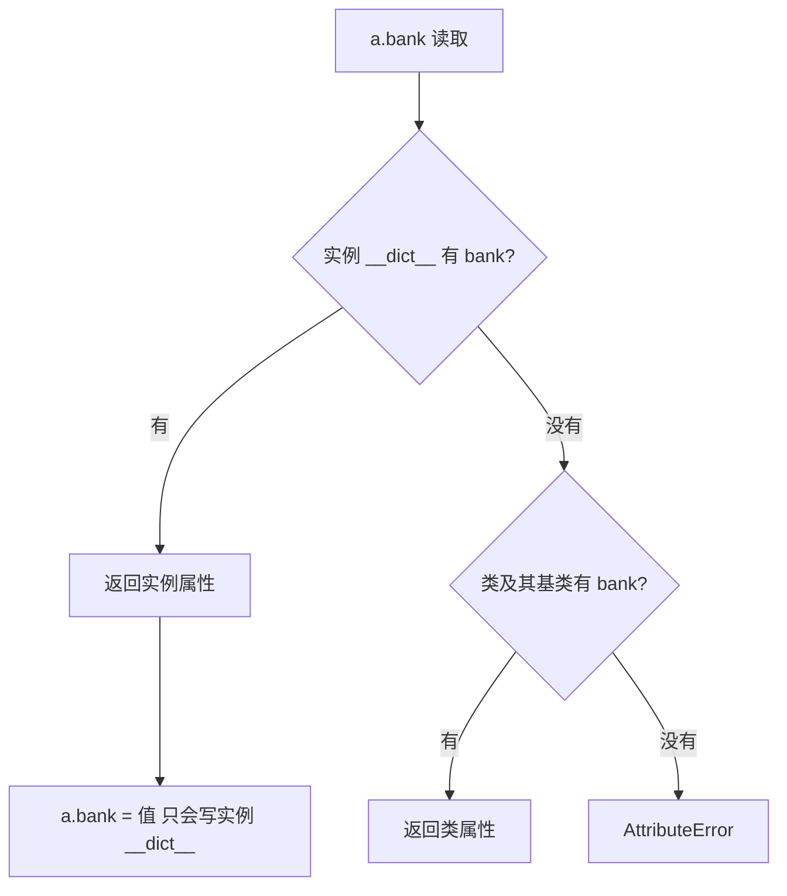

Python 的类是一个普通对象:定义类时创建了一个类对象,实例化时再创建实例对象。理解"类对象 / 实例对象 / 属性存放位置"这三件事,大部分类相关的困惑都能解开。

## 类对象与实例对象

```python
class Account:
    bank = "示例银行"          # 类属性:定义在类体,由所有实例共享

    def __init__(self, owner, balance=0):
        self.owner = owner      # 实例属性:每个实例各自一份
        self.balance = balance

    def deposit(self, amount):
        self.balance += amount

a = Account("Ada", 100)
b = Account("Bob")
a.bank, b.bank      # 都是 "示例银行"
a.owner             # "Ada"
```

`Account` 是类对象,`a`、`b` 是实例对象。`__init__` 负责给实例写入初始属性,但它不是"创建对象"的那一步:对象已经由 `__new__` 创建好,`__init__` 只是在它身上初始化。需要控制创建过程(单例、不可变类型、从缓存取对象)时才重写 `__new__`,日常业务几乎只写 `__init__`。

## 属性查找:先实例,后类

读取 `a.bank` 时,解释器先看实例的 `__dict__`,没有再看类的。赋值 `a.bank = "x"` 则在实例的 `__dict__` 里新建一条,不会改到类属性:

```python
a.bank = "另一家"
a.bank      # "另一家"
b.bank      # "示例银行",不受影响
Account.bank  # "示例银行"
```



这条规则带来一个常见陷阱:**可变类属性被所有实例共享**。把列表写成类属性,再通过实例就地修改,改的是类上的那一份:

```python
class Cart:
    items = []                  # 错:所有实例共享同一个列表
    def add(self, x):
        self.items.append(x)    # 就地修改,写的是类属性

Cart().add(1); Cart().add(2)
Cart().items        # [1, 2],两个实例看到同一份
```

正确做法是在 `__init__` 里创建实例属性:`self.items = []`。不可变类属性(字符串、数字)没有这个问题,因为"修改"会重新绑定,只在实例上写新值。

## 三种方法的绑定方式

| 定义 | 第一个参数 | 通过实例调用 | 通过类调用 |
| --- | --- | --- | --- |
| 普通方法 `def m(self)` | 实例本身 | 自动传入实例 | 需手动传实例 |
| `@classmethod def m(cls)` | 类本身 | 自动传入类 | 自动传入类 |
| `@staticmethod def m()` | 不传 | 不传 | 不传 |

```python
class Temperature:
    def __init__(self, celsius):
        self.celsius = celsius

    def to_fahrenheit(self):            # 需要实例数据
        return self.celsius * 9 / 5 + 32

    @classmethod
    def from_fahrenheit(cls, f):        # 替代构造器
        return cls((f - 32) * 5 / 9)

    @staticmethod
    def valid(c):                       # 与实例和类都无关的工具函数
        return c >= -273.15
```

`classmethod` 的典型用途是提供第二个构造入口,`cls` 让子类调用时返回子类实例。`staticmethod` 只是把函数挂在类的命名空间下,没有隐式参数;它与模块级函数相比多了"归属明确"的好处。

## self 是什么

`self` 不是关键字,只是实例方法的第一个参数的惯用名。`a.deposit(10)` 的调用过程是:先从类上取出函数对象 `Account.deposit`,再把 `a` 作为第一个实参传入,等价于 `Account.deposit(a, 10)`。所谓"绑定方法",就是解释器帮你完成了这一步。

因此实例方法必须至少有一个参数接收实例;忘写 `self` 会在调用时收到实参数量不匹配的 TypeError。

## 访问控制:约定而非强制

Python 没有 `private` 关键字,靠命名约定:

- `_name`:内部使用,提示"别从外部依赖";
- `__name`(双下划线开头、末尾至多一个下划线):触发名称改写,在类 `A` 内变成 `_A__name`,避免子类意外覆盖;
- `__name__`(前后双下划线):语言保留的特殊名字,不要自定义。

```python
class Box:
    def __init__(self):
        self.__secret = 1       # 实际存为 _Box__secret

Box()._Box__secret              # 1,约定挡不住刻意访问
```

需要限制实例可挂哪些属性、并省一点内存时用 `__slots__`:

```python
class Point:
    __slots__ = ("x", "y")
    def __init__(self, x, y):
        self.x, self.y = x, y
```

`__slots__` 让实例不再有 `__dict__`,写未声明的属性会抛 AttributeError;代价是失去动态加属性的能力,多重继承时也要留意布局冲突。

## 小结

- 类是对象,实例化由 `__new__` 创建、`__init__` 初始化;
- 读取属性先实例后类,赋值只写实例;可变类属性会被所有实例共享;
- 实例方法收实例,`classmethod` 收类(常用于替代构造器),`staticmethod` 不收;
- `self` 只是第一个参数的惯用名,绑定方法等价于手动传入实例;
- 访问控制靠下划线约定,`__slots__` 用于限制属性与节省内存。
