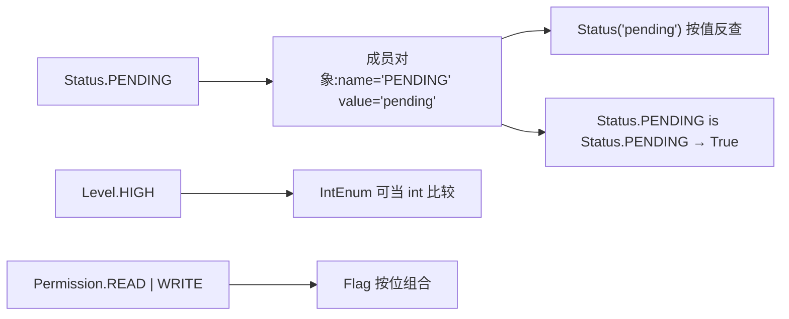

存数据的类往往只有一堆字段和几行样板方法:`__init__` 逐个赋值、`__repr__` 拼字符串、`__eq__` 逐字段比较。dataclass 把这些交给装饰器生成,让代码回到字段定义本身。

## 基本用法

```python
from dataclasses import dataclass

@dataclass
class Point:
    x: float
    y: float = 0.0

p = Point(1.5)
p        # Point(x=1.5, y=0.0)
Point(1, 0) == Point(1, 0)   # True
```

`@dataclass` 读取类里的注解,生成 `__init__`、`__repr__`、`__eq__`。字段顺序就是参数顺序;带默认值的字段必须排在无默认值字段之后,与函数参数规则一致。

只写注解、不赋值的字段是必填字段;赋了值就是默认值。注解只用于生成签名与类型提示,不参与运行时检查。

## 可变默认值用 field

dataclass 会拦截可变默认值,直接写 `items: list = []` 会抛 ValueError,因为那个默认值会被所有实例共享(和函数默认参数的陷阱同源)。正确写法是 `default_factory`:

```python
from dataclasses import dataclass, field

@dataclass
class Order:
    id: str
    items: list[str] = field(default_factory=list)
    tags: set[str] = field(default_factory=set)
    note: str = field(default="", repr=False)   # 不出现在 repr 里
```

`default_factory` 接收一个无参可调用对象,每次创建实例时调用一次。`field` 还能控制 `compare`(是否参与相等)、`metadata`(第三方库读取的附加信息)等。

## 常用开关

```python
@dataclass(frozen=True, order=True, slots=True)
class Money:
    amount: Decimal
    currency: str = "CNY"
```

- `frozen=True`:实例不可变,赋值抛 FrozenInstanceError,同时生成 `__hash__`,可作 dict 键;
- `order=True`:按字段顺序生成比较方法,可用于排序;
- `slots=True`(3.10+):生成 `__slots__`,省内存并阻止动态加属性;
- `kw_only=True`(3.10+):全部字段改为仅限关键字,避免位置参数含义不清;
- `eq=False`:不生成 `__eq__`,保留默认的按身份比较(需要自定义相等时用)。

`frozen` 只是浅冻结:字段本身不可重新绑定,但字段指向的列表仍可被修改。需要完全不可变,字段也必须是不可变类型。

## __post_init__:生成之后的校验

`__init__` 由装饰器生成,想在其中插入逻辑,写 `__post_init__`:

```python
@dataclass
class Interval:
    start: int
    end: int

    def __post_init__(self):
        if self.start > self.end:
            raise ValueError("start 不能大于 end")
```

它会在生成 `__init__` 的末尾被调用。需要派生字段、归一化输入、校验不变量时放这里。`frozen=True` 时只能用 `object.__setattr__(self, "name", value)` 修改字段。

## 与 NamedTuple、TypedDict 的分工

| 类型 | 运行时形态 | 适合 |
| --- | --- | --- |
| `@dataclass` | 普通类实例 | 有方法、校验、可变或不可变的数据对象 |
| `NamedTuple` | 元组子类 | 轻量、不可变、可解包、需要像元组一样使用 |
| `TypedDict` | 仍是 dict | 描述 JSON / 配置字典的键类型,不生成运行时类 |
| `attrs` | 第三方库 | 需要更细的校验器与转换器时 |

dataclass 生成的是普通类,能加方法、能继承、能用描述符;NamedTuple 继承元组,有下标和解包能力,但字段不可变且方法扩展有限;TypedDict 只服务类型检查,运行时还是 dict。

## 枚举

枚举把一组命名常量收成一个类型,避免散落的字符串或魔法数字:

```python
from enum import Enum, IntEnum, Flag, auto

class Status(Enum):
    PENDING = "pending"
    DONE = "done"

class Level(IntEnum):
    LOW = 1
    HIGH = 2

class Permission(Flag):
    READ = auto()
    WRITE = auto()
    ALL = READ | WRITE
```



- `Enum`:成员唯一,按身份比较,`Status.PENDING == "pending"` 为 False;
- `IntEnum`:成员同时是 int 子类,能和整数比较、能参与算术,适合需要与 C 接口或旧代码互通;
- `Flag`:成员可组合,`Permission.READ | Permission.WRITE` 得到组合值;
- `auto()`:自动给值,默认从 1 递增。

枚举成员在导入时创建,之后不能新增。需要序列化时,用 `.value` 取值、用 `Status(value)` 反查;直接 `json.dumps` 枚举成员会报错,通常配 default 函数或 `str, Enum` 混入。

## 选择建议

- 内部数据结构优先 dataclass,字段多、需要校验或方法时尤其合适;
- 不可变的小记录(坐标、区间)可以用 frozen dataclass 或 NamedTuple;
- 只在类型标注里描述外部 JSON 时用 TypedDict,不要为了"有个类"而建 dataclass;
- 状态、级别、权限这类有限集合用 Enum,不要用字符串常量。

## 小结

- dataclass 从注解生成 `__init__`/`__repr__`/`__eq__`,字段顺序即参数顺序;
- 可变默认值必须用 `default_factory`,否则所有实例共享;
- `frozen` 提供不可变与哈希,`order`/`kw_only`/`slots` 按需开启;
- 校验与派生字段写在 `__post_init__`;
- 数据对象用 dataclass,元组式记录用 NamedTuple,外部 JSON 用 TypedDict,有限集合用 Enum。
