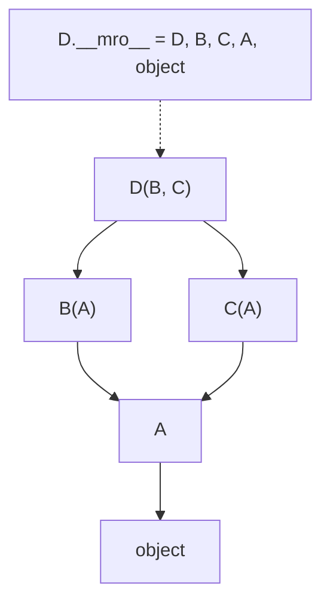

继承解决的是"复用与替代"两件事:子类复用父类的实现,同时保证在期望父类的地方可以传入子类(里氏替换)。Python 允许多重继承,这就需要一套确定的查找顺序,MRO 就是那套规则。

## 单继承与方法覆盖

```python
class Animal:
    def speak(self):
        return "..."

class Dog(Animal):
    def speak(self):          # 覆盖父类方法
        return "woof"
```

调用 `Dog().speak()` 时,先从 `Dog` 上找,找到就直接用,不会继续往上。要在子类里扩展而不是替换,用 `super()` 调下一个实现:

```python
class LoudDog(Dog):
    def speak(self):
        return super().speak().upper()
```

## super() 的真实含义

`super()` 返回一个代理对象,它**不代表父类**,而是"沿 MRO 中当前类的下一个类"开始查找。单继承时下一个类恰好是父类,所以看起来像"调父类";多重继承时,它可能跳到一个兄弟类。

这也是协作式多重继承能工作的前提:每个类只调用 `super()`,让链条上的每个实现都轮到一次。

## MRO:C3 线性化

每个类都有 `__mro__`,记录方法解析顺序。规则可以概括为:

1. 子类排在自己的基类之前;
2. 多个基类按声明顺序;
3. 保持每个基类自身的相对顺序;
4. 不允许出现循环依赖的顺序矛盾。

```python
class A: pass
class B(A): pass
class C(A): pass
class D(B, C): pass

D.__mro__
# (D, B, C, A, object)
```



`D` 的方法查找顺序是 D → B → C → A → object。注意 `C` 排在 `A` 前面:即使 B 和 C 都继承 A,A 也只能出现一次,且必须在所有子类之后。Python 用 C3 算法计算这个序列,声明顺序无法满足时在类定义阶段直接抛 TypeError,不会等到运行时。

## 菱形继承与协作式 super

```python
class Base:
    def __init__(self):
        print("Base")

class Left(Base):
    def __init__(self):
        print("Left")
        super().__init__()

class Right(Base):
    def __init__(self):
        print("Right")
        super().__init__()

class Diamond(Left, Right):
    def __init__(self):
        print("Diamond")
        super().__init__()

Diamond()
# Diamond → Left → Right → Base
```

`Diamond` 的 MRO 是 Diamond, Left, Right, Base, object。`Left.__init__` 里的 `super()` 沿 MRO 找到 `Right`,而不是直接找 `Base`;`Right` 再往下才到 `Base`。所以 `Base.__init__` 只执行一次。

如果某个类在链条中写死了 `Base.__init__(self)` 而不走 `super()`,链条就断了,其余兄弟类的初始化会被跳过。这是多重继承里最常见的错误。

## mixin:用多重继承做能力组合

mixin 是只提供一小块能力、不单独实例化的类:

```python
class JsonMixin:
    def to_json(self):
        import json
        return json.dumps(self.__dict__, ensure_ascii=False)

class User(JsonMixin):
    def __init__(self, name):
        self.name = name

User("Ada").to_json()      # '{"name": "Ada"}'
```

mixin 的约定:类名以 Mixin 结尾、不写 `__init__`、方法保持独立、通过 `super()` 与其他 mixin 协作。它适合"横切能力"(序列化、比较、日志),不适合表达"是一个"的关系。真正的 is-a 关系用单继承,组合优先于继承。

## 抽象基类:把约定变成约束

普通父类的方法可以被覆盖也可以不用;抽象基类用 `abc` 强制子类实现指定方法:

```python
from abc import ABC, abstractmethod

class Repository(ABC):
    @abstractmethod
    def get(self, key): ...

    @abstractmethod
    def put(self, key, value): ...

class MemoryRepo(Repository):
    def get(self, key): ...
    def put(self, key, value): ...

MemoryRepo()        # 可以实例化
Repository()        # TypeError:不能实例化抽象类
```

抽象方法可以带实现,供子类通过 `super()` 复用。`ABC` 与 `Protocol`(结构化子类型)解决的是两个方向的问题:前者要求显式继承,后者只看方法形状,第 6 章讲迭代协议时会再次遇到"协议"这个概念。

## 继承的取舍

- 继承表达 is-a,组合表达 has-a;能用组合就不要继承;
- 继承层级尽量浅,超过三层通常说明职责没有拆清;
- 多重继承只用于 mixin,且所有类都用 `super()` 协作;
- 需要"必须实现"的约束时用 ABC,需要"长得像就行"时用 Protocol。

## 小结

- `super()` 沿 MRO 找下一个类,不是写死父类;
- MRO 由 C3 线性化决定,子类在前、基类在后,矛盾在定义时报错;
- 菱形继承靠协作式 `super()` 保证每个初始化只执行一次;
- mixin 组合横切能力,is-a 关系才用继承;
- 抽象基类强制子类实现,`Protocol` 提供结构化匹配。
