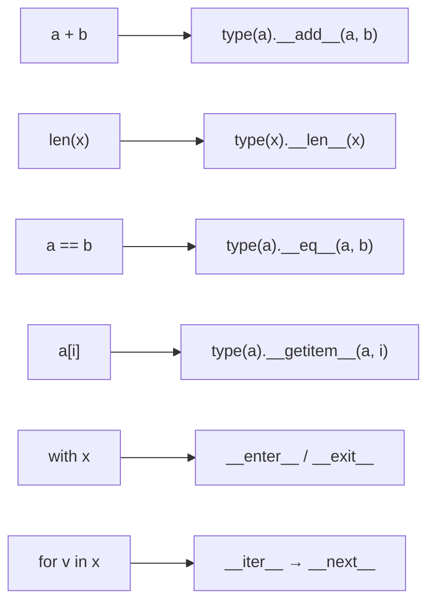

魔术方法是 Python 数据模型的接口层:表达式、内置函数、语句在遇到自定义对象时,会去调用对应的特殊方法。`a + b` 找 `__add__`,`len(x)` 找 `__len__`,`for` 找 `__iter__`。所谓"协议",就是这组约定的方法集合。

## 表达式如何落到方法



这些方法不通过 `a.__add__(b)` 的显式写法调用,而是由语法在解释器内部触发。这也是"魔术"一词的由来:调用发生在你写下的符号背后。

## 用向量类走一遍

```python
class Vector:
    def __init__(self, x, y):
        self.x, self.y = x, y

    def __repr__(self):                 # repr(v)、调试器、容器显示
        return f"Vector({self.x}, {self.y})"

    def __eq__(self, other):            # v1 == v2
        if not isinstance(other, Vector):
            return NotImplemented
        return (self.x, self.y) == (other.x, other.y)

    def __add__(self, other):           # v1 + v2
        if not isinstance(other, Vector):
            return NotImplemented
        return Vector(self.x + other.x, self.y + other.y)

    def __len__(self):                  # len(v)
        return 2

    def __getitem__(self, i):           # v[0]
        return (self.x, self.y)[i]
```

要点:

- `__repr__` 面向开发者,返回能重建对象的表达式;没有 `__str__` 时 `str()` 也会退到它;
- `__eq__` 在不认识对方类型时返回 `NotImplemented`(注意不是 `NotImplementedError`),让解释器尝试对方的实现;
- `__add__` 对向量做逐元素相加,返回**新对象**,不改原对象;
- `__len__` 让 `bool(v)` 也有意义:长度为 0 视为假;
- `__getitem__` 让对象可下标访问,同时开启旧式迭代(有 `__getitem__` 且无 `__iter__` 时,`for` 会从索引 0 开始取到 IndexError)。

## __eq__ 与 __hash__ 必须一起考虑

定义了 `__eq__` 却没有定义 `__hash__`,类会被自动设为不可哈希:实例不能放进 set,也不能做 dict 的键。原因是相等的对象必须有相同的哈希,自定义相等后默认的"按身份哈希"已经不正确。

```python
class Point:
    def __init__(self, x, y): self.x, self.y = x, y
    def __eq__(self, o): return isinstance(o, Point) and (self.x, self.y) == (o.x, o.y)
    def __hash__(self): return hash((self.x, self.y))

{Point(1, 2), Point(1, 2)}      # 只有一个元素
```

哈希基于的字段必须是不可变的,且与 `__eq__` 使用的字段一致。可变对象(列表、字典)不适合做键,因为改内容会改变哈希,字典将找不到原来的桶。

## 比较与排序

`__lt__` 等比较方法决定 `<`、`>`、`<=` 的行为,`sorted` 依赖它们。`functools.total_ordering` 可以根据 `__eq__` 和一个比较方法补齐其余:

```python
from functools import total_ordering

@total_ordering
class Version:
    def __init__(self, parts): self.parts = tuple(parts)
    def __eq__(self, o): return self.parts == o.parts
    def __lt__(self, o): return self.parts < o.parts
```

## 其他常用钩子

| 协议 | 方法 | 触发方式 |
| --- | --- | --- |
| 字符串表示 | `__repr__` / `__str__` | `repr()` / `str()`、`print` |
| 真值 | `__bool__` | `if obj`、`not obj` |
| 容器 | `__len__` / `__contains__` | `len()` / `in` |
| 迭代 | `__iter__` / `__next__` | `for`、`list()` |
| 算术 | `__add__` / `__radd__` / `__iadd__` | `+`、反射、`+=` |
| 上下文 | `__enter__` / `__exit__` | `with` |
| 可调用 | `__call__` | `obj()` |
| 属性访问 | `__getattr__` / `__setattr__` | 读写属性 |

反射方法 `__radd__` 处理"左操作数不认识右操作数"的情况;`__iadd__` 决定 `+=` 是否就地修改。`__getattr__` 只在正常查找失败时调用,`__getattribute__` 则拦截所有访问,后者容易写出递归,除非必要不要重写。

## 不要滥用的部分

- 魔术方法必须由语法触发,手动调用 `obj.__len__()` 通常说明设计有问题;
- 不要用 `__getattr__` 静默吞掉拼错的属性名,调试成本极高;
- `__eq__` 要返回布尔值或 `NotImplemented`,不要返回其他类型;
- 实现了 `__iter__` 的对象如果同时是迭代器,`__iter__` 应返回自身,否则 `for` 的语义会分裂。

## 小结

- 语法与内置函数通过魔术方法落到自定义对象,这组方法构成协议;
- `__repr__` 面向调试,`__eq__` 返回布尔或 NotImplemented;
- 自定义 `__eq__` 后必须同步定义 `__hash__`,且哈希字段不可变;
- 容器、迭代、比较、上下文各有对应的协议方法;
- 魔术方法由解释器触发,只在实现协议时定义,不要用它做普通方法调用。
