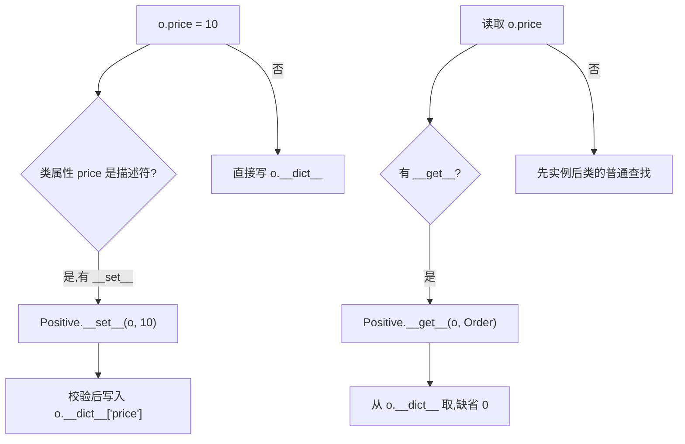

直接暴露实例属性最简单,但一旦需要校验、派生或延迟计算,裸属性就不够用了。Python 提供两层工具:轻量的 `property`,以及更底层的描述符协议。property 本身就是用描述符实现的。

## property:方法伪装成属性

```python
class Temperature:
    def __init__(self, celsius=0):
        self._celsius = celsius

    @property
    def celsius(self):                 # 读 t.celsius 时执行
        return self._celsius

    @celsius.setter
    def celsius(self, value):          # 写 t.celsius = v 时执行
        if value < -273.15:
            raise ValueError("低于绝对零度")
        self._celsius = value

    @celsius.deleter
    def celsius(self):                 # del t.celsius 时执行
        raise AttributeError("不支持删除")
```

`@property` 把 getter 变成属性访问;`.setter`、`.deleter` 分别挂上写与删。外部看到的是 `t.celsius = 20`,实际执行的是 setter 里的校验。内部数据存在 `_celsius`,用下划线表示"不要直接碰"。

三个方法必须同名,否则 `@x.setter` 找不到要扩展的 property 对象。这是初学者最常见的错误。

## 计算属性与缓存

只读的计算属性不需要 setter:

```python
class Circle:
    def __init__(self, r): self.r = r

    @property
    def area(self):
        return 3.1415926 * self.r ** 2
```

每次访问都重新计算。如果计算昂贵且输入不变,用 `functools.cached_property`:

```python
from functools import cached_property

class Report:
    def __init__(self, rows): self.rows = rows

    @cached_property
    def summary(self):                 # 第一次访问算一次,结果写入实例 __dict__
        return expensive_aggregate(self.rows)
```

`cached_property` 要求实例有 `__dict__`(用了 `__slots__` 就不行),且缓存的键就是属性名。它不提供失效机制,底层数据变了要手动 `del obj.summary` 或重新创建对象。

## 描述符协议

描述符是定义了 `__get__`、`__set__`、`__delete__` 中任意一个的类。它作为**类属性**存在时,实例上的读写会被转发给这几个方法:

```python
class Positive:
    def __set_name__(self, owner, name):   # 类创建时拿到属性名
        self.name = name

    def __get__(self, obj, objtype=None):
        if obj is None:
            return self                    # 通过类访问,返回描述符本身
        return obj.__dict__.get(self.name, 0)

    def __set__(self, obj, value):
        if value < 0:
            raise ValueError(f"{self.name} 必须非负")
        obj.__dict__[self.name] = value

class Order:
    price = Positive()
    quantity = Positive()
```



`price = Positive()` 写在类体里,等于给类装了一个"属性控制器"。每个需要用同样规则校验的字段各放一个实例,`__set_name__` 自动把属性名告诉描述符,不必手写字符串。

这段代码也说明 property 与描述符的关系:`property` 是一个内置描述符类型,`@property` 只是创建它的语法糖。区别在于 property 绑定在单个类的单个属性上,描述符类可以复用到任意多个类与字段。

## 数据描述符与非数据描述符

- 定义了 `__set__` 或 `__delete__` 的描述符叫**数据描述符**,优先级高于实例 `__dict__`:`o.price` 会走 `__get__`,即使实例里存了同名键;
- 只有 `__get__` 的叫**非数据描述符**,实例 `__dict__` 优先。函数就是非数据描述符,所以实例可以覆盖方法;
- 因此上面的 `Positive` 把值存进 `obj.__dict__[self.name]`,读取时却由 `__get__` 负责,这正是数据描述符的用法。

函数、`classmethod`、`staticmethod`、`property` 都是描述符。理解这一点,才能解释"为什么实例方法会自动带上 self"。

## 什么时候用哪种

| 需求 | 工具 |
| --- | --- |
| 单个字段的校验或派生 | `property` |
| 昂贵计算、结果可复用 | `cached_property` |
| 同一规则套在多个字段上 | 自定义描述符 |
| 只读的轻量派生值 | 普通 `@property`,不必缓存 |
| 需要序列化参与 | 考虑 dataclass 字段(下一篇) |

不要为了"封装"把所有字段都套上 property:没有校验、没有派生、没有副作用时,裸属性更好读,也更快。property 适合表达"这个值不是简单存储",而不是给每个字段加一层样板代码。

## 小结

- property 用 getter/setter/deleter 把方法变成属性,三者必须同名;
- 计算属性每次重算,`cached_property` 首次计算后写入实例字典;
- 描述符通过 `__get__`/`__set__`/`__delete__` 接管属性访问,`__set_name__` 可获得字段名;
- 含 `__set__` 的是数据描述符,优先级高于实例字典;函数是非数据描述符;
- 没有校验与派生需求时,直接暴露属性。
