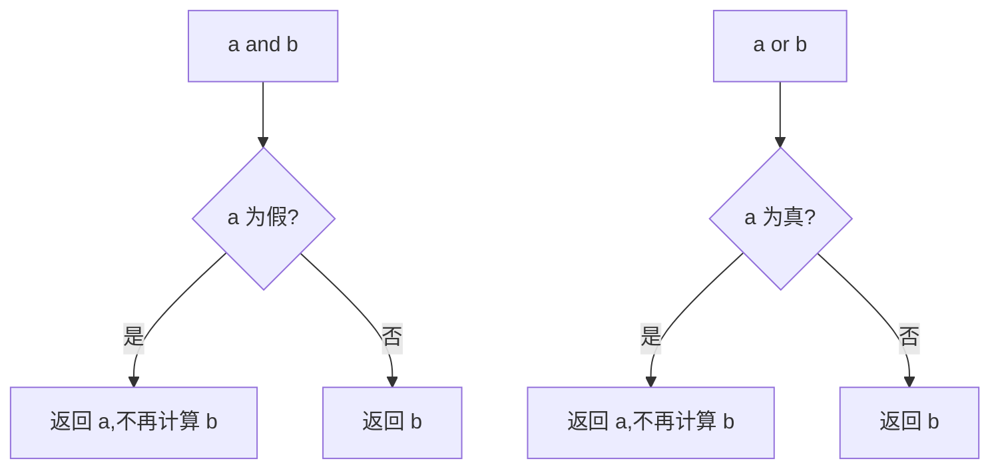

运算符决定表达式怎么算。Python 有几处与直觉不同的语义:and/or 返回操作数、比较可以链式、增强赋值对可变与不可变行为不同。这一篇逐个讲清。

## 算术与比较

- 算术:`+ - * / // % **`。`/` 真除永远得 float;`//` 整除;`**` 幂,右结合(`2 ** 3 ** 2 == 2 ** 9`);
- 比较:`== != < <= > >=`,可**链式**:`1 < x < 10` 等价 `1 < x and x < 10`,且 x 只求值一次;
- 位运算:`& | ^ ~ << >>`,作用于 int。

## 逻辑运算:短路且返回操作数

and/or 不返回 True/False,而返回**决定结果的那个操作数**:

```python
0 or "default"      # 'default'(0 为假,取右)
"a" and "b"         # 'b'(左真,结果取决于右)
"" or None or 3     # 3
```

短路:and 左假即停,or 左真即停。惯用法 `x = x or default` 给空值兜底,但注意 0/""/[] 也被视为假,若它们可能是合法值应改用 `x if x is not None else default`。



not 返回布尔。真值判断:0、0.0、""、[]、{}、set()、None 为假,其余为真(对象可实现 __bool__/__len__ 自定义)。

## 成员与身份

- `in` / `not in`:成员判断,序列线性查、字典/集合哈希查(第 3 章);
- `is` / `is not`:身份判断,只用于 None 等单例(第 2.1 篇)。

## 增强赋值:就地还是改绑

`+=` 等先尝试就地方法(__iadd__),不存在则算新值再改绑:

```python
a = [1]; b = a
a += [2]        # 就地扩展,b 也变 [1, 2]
a = a + [3]     # 新列表改绑,b 仍 [1, 2]

t = (1,); u = t
t += (2,)       # 元组无 __iadd__,新对象改绑,u 仍 (1,)
```

注意:对不可变对象,`t += …` 与 `t = t + …` 效果相同;对可变对象两者**不同**,别名是否可见是分界。这条是第 3 章拷贝问题的伏笔。

## 优先级与括号

从高到低大致:`**` → 一元 `+ - ~` → `* / // %` → `+ -` → 移位 → `&` → `^` → `|` → 比较/成员/身份 → `not` → `and` → `or` → 条件表达式 → lambda → 赋值表达式。

记不住就加括号。两个易错:`-2 ** 2 == -4`(幂优先于一元负号);`not a == b` 等价 `not (a == b)`(比较优先于 not)。

## 条件表达式与海象

```python
label = "成年" if age >= 18 else "未成年"     # 三元
if (n := len(data)) > 10:                    # 海象(3.8+):赋值并返回值
    print(n)
```

海象把"赋值+判断"合一,避免重复计算;只在能减少重复时用,不要为炫技嵌套。

## 小结

- / 真除得 float,// 整除,** 右结合;
- 比较可链式,中间只求值一次;
- and/or 短路并返回操作数,兜底注意 0/"" 的假值;
- in 成员、is 身份(仅单例);
- 增强赋值:可变就地(别名可见)、不可变改绑;
- 优先级易错:-2**2、not a==b;不确定加括号;
- 条件表达式与海象减少重复。

下一篇讲分支与循环。
