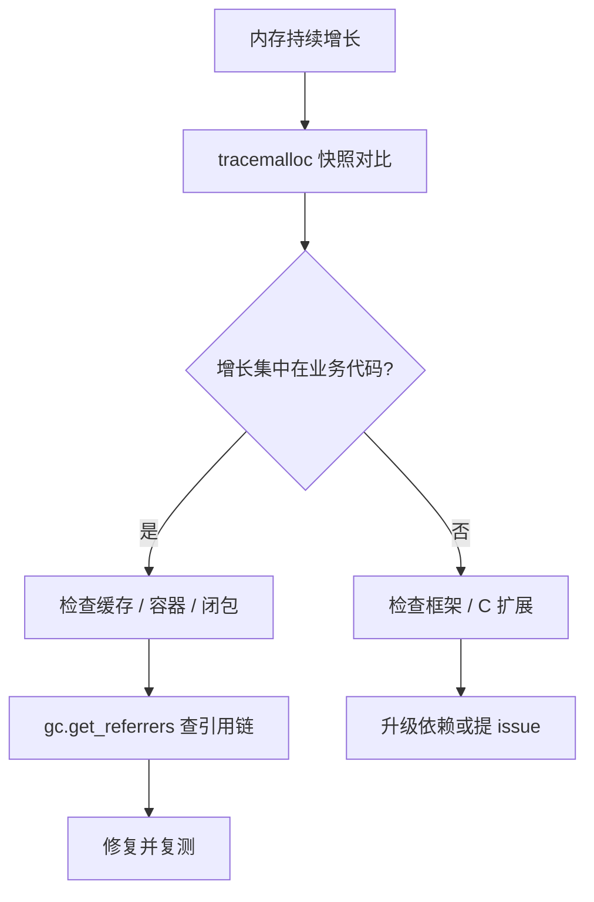

Python 的内存管理分两层:引用计数负责绝大多数对象的即时回收,循环垃圾回收器负责处理互相引用的对象。理解这两层,才能解释"对象为什么没被释放"。

## 引用计数

每个对象记录自己被引用的次数,归零立即释放:

```python
import sys

a = []
sys.getrefcount(a)      # 2(函数实参本身也算一次)
b = a
sys.getrefcount(a)      # 3
del b
sys.getrefcount(a)      # 2
```

增加计数的典型操作:赋值给名字、放进容器、作为参数传递、被闭包捕获。减少:离开作用域、`del`、容器被销毁、重新绑定名字。

引用计数的优点是即时:对象一旦不可达就立刻释放,不需要等 GC。缺点是维护计数有开销,而且处理不了循环引用。

## 循环引用

```python
class Node:
    def __init__(self):
        self.peer = None

a, b = Node(), Node()
a.peer, b.peer = b, a
del a, b
# 两个对象互相引用,计数都不为 0,引用计数无法回收
```

这时需要循环垃圾回收器:它定期扫描容器对象,找出"只被循环引用的不可达对象"并回收。gc 按代管理,新对象在第 0 代,存活越久代越高,扫描频率越低。

```python
import gc

gc.collect()               # 手动触发全量回收
gc.get_count()             # 各代对象计数
gc.get_threshold()         # (700, 10, 10) 默认阈值
gc.set_debug(gc.DEBUG_SAVEALL)
```

`gc.collect()` 通常在测试或收尾时用,不要在生产热路径里频繁调用:全量扫描会停顿。容器对象(自定义类实例、dict、list)才参与循环检测,整数、字符串等不参与。

## 内存滞留的常见来源

对象没被释放,通常不是"GC 失效",而是仍有引用:

- **全局缓存**:字典只增不删,应该用有界缓存(`lru_cache(maxsize=)`)或定期清理;
- **闭包**:外层变量被内层函数引用,函数对象存活,变量就存活;
- **循环引用**:对象互相引用,需要 GC 或显式断开;
- **异常对象**:traceback 持有栈帧与局部变量,长期保存异常会拖住整条调用链;
- **线程/任务**:长驻线程持有引用,任务未取消就一直挂起;
- **C 扩展**:引用计数管理错误导致泄漏,只能靠工具定位;
- **缓存 key 是可变对象**:无法命中又不断新增。

## tracemalloc:定位分配来源

```python
import tracemalloc

tracemalloc.start()

# ... 运行可疑逻辑 ...

snapshot = tracemalloc.take_snapshot()
for stat in snapshot.statistics("lineno")[:10]:
    print(stat)
```

```text
/opt/app/service.py:84: 12.5 MiB
/opt/app/cache.py:31: 4.0 MiB
```

它按文件与行号汇总当前分配的字节数,直接指出"哪一行分配了多少"。两种用法:

- 运行前后各取一次快照,`compare_to` 看增量;
- 长期运行的服务定期采样,观察增长趋势。

`tracemalloc` 有额外开销,只在排查阶段开启。

## weakref:不持有所有权

```python
import weakref

class Cache:
    def __init__(self):
        self._items = weakref.WeakValueDictionary()

    def put(self, key, value):
        self._items[key] = value      # 不增加引用计数

    def get(self, key):
        return self._items.get(key)
```

`weakref` 不增加引用计数,对象被回收后条目自动消失。适合"缓存但不应阻止回收"、"父子引用回指父对象"、"观察者列表"这类场景。注意不是所有对象都支持弱引用(带 `__slots__` 且未声明 `__weakref__` 的类不支持)。

## __slots__ 与对象开销

```python
class Point:
    __slots__ = ("x", "y")
```

普通实例有 `__dict__`(一个哈希表),字段多、实例多时开销显著。`__slots__` 把字段放进固定槽,省内存也略快,代价是不能动态加属性,且多重继承时要注意布局。数据类可以开 `slots=True`。

## 排查顺序

1. 复现:稳定增长还是偶发?
2. 观察:`tracemalloc` 或 `memory_profiler` 找增长最快的分配点;
3. 检查缓存与容器:是否只增不删,key 是否可控;
4. 检查引用链:`gc.get_referrers(obj)` 看谁在引用;
5. 检查生命周期:线程、任务、异常、回调是否长期持有;
6. 修复后同样方式复测,确认增长停止。



## 常见问题

- **用 del 期待立即释放**:还有别的引用时不会释放;
- **手动频繁 gc.collect()**:带来停顿,不解决泄漏;
- **保留异常对象**:traceback 引用栈帧,应记录后用 `del e` 或 `e.__traceback__ = None` 断开;
- **无界缓存**:最常见的"泄漏",本质是设计问题;
- **只看进程 RSS**:分配器缓存与碎片也会让 RSS 不降,结合 tracemalloc 判断。

## 小结

- 引用计数即时回收,循环引用交给分代 GC;
- 对象不释放通常是仍有引用,而不是 GC 没工作;
- 全局缓存、闭包、异常对象、长驻任务是最常见的滞留来源;
- tracemalloc 按行定位分配,`gc.get_referrers` 查引用链;
- weakref 与 `__slots__` 分别解决"不持有所有权"与"对象开销"。
