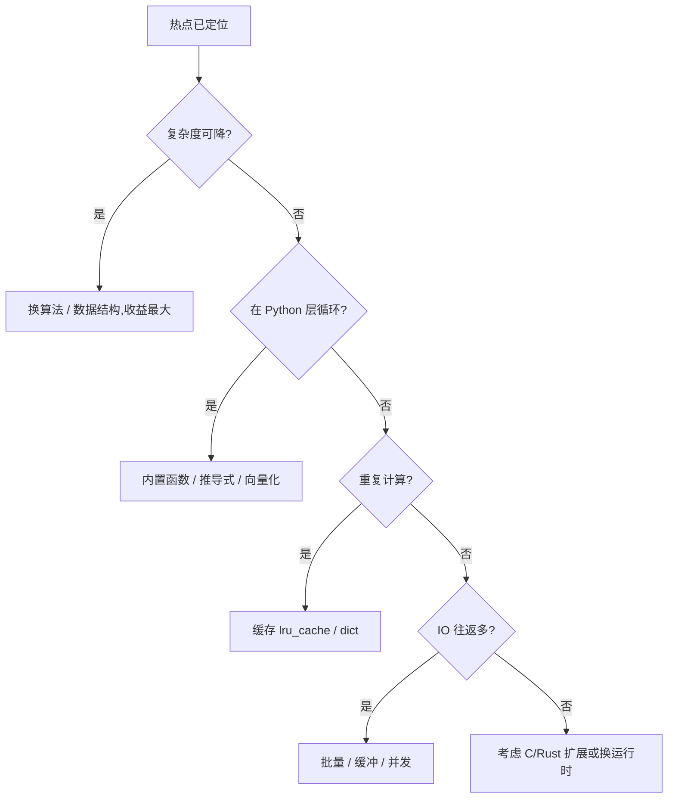

热点定位之后,优化手段的收益差别很大。按从高到低排:算法与数据结构、减少 Python 层循环、缓存重复计算、借助 C/Rust 扩展。顺序反过来做,通常是在微调常数。

## 算法优先

```python
# O(n^2):每个元素都扫描一遍列表
def has_duplicate(xs):
    for i, x in enumerate(xs):
        if x in xs[i + 1:]:
            return True
    return False

# O(n):集合查找
def has_duplicate(xs):
    seen = set()
    for x in xs:
        if x in seen:
            return True
        seen.add(x)
    return False
```

数据结构换对了,复杂度降一个量级,收益远超任何写法优化。先确认:查找是否用了 list、计数是否用了嵌套循环、去重是否用了两次遍历、排序是否在循环里反复执行。

## 用内置与 C 实现

内置函数和标准库的关键路径是 C 实现,通常比手写循环快:

```python
sum(xs)                    # 优于手写累加
any(pred(x) for x in xs)   # 短路,遇到第一个就停
max(xs, key=...)           # 优于手写比较
list(map(str, xs))         # C 层调用
"-".join(parts)            # 优于 += 拼接
```

推导式比显式 for 加 append 快,因为循环体在 C 层执行:

```python
squares = [x * x for x in xs]          # 优于 for + append
```

但推导式不要嵌套太深,可读性下降后收益不值得。

## 缓存

```python
from functools import lru_cache

@lru_cache(maxsize=1024)
def parse_config(path: str) -> dict:
    ...
```

缓存适合"纯函数 + 参数可哈希 + 调用频繁"。注意:

- 参数不可哈希(list、dict)无法缓存,先转成 tuple/frozenset;
- 依赖外部状态(文件、时间、数据库)的函数缓存后会返回过期结果;
- `maxsize` 必须设上限,否则缓存本身就是内存泄漏;
- 多进程下每个进程一份缓存,不共享。

需要按 key 手动管理时用 dict 加过期策略,或者专门的缓存库。`lru_cache` 是最轻的方案,不是万能的。

## 字符串与 IO

```python
# 错:每次 += 都产生新字符串,O(n^2)
result = ""
for line in lines:
    result += line

# 对:一次 join
result = "".join(lines)
```

```python
# 错:每条记录一次写系统调用
for row in rows:
    f.write(row)

# 对:攒批或使用缓冲
f.writelines(rows)
```

IO 的开销远大于内存操作。批量读写、设置缓冲区大小、减少往返次数,收益通常比改算法还直接。数据库同理:逐条 INSERT 换成批量,数量级差别。

## 减少属性与全局查找

在热点循环里,属性访问与全局查找比局部变量慢:

```python
def total(items):
    local_append = result_append      # 提前取出方法或全局名字
    for item in items:
        local_append(item.price)
```

这类优化只在确认是热点后做,而且会牺牲可读性。多数情况下,`for` 循环本身的开销比属性查找更大,应该先考虑用内置聚合替代整个循环。

## 向量化与并行

```python
import numpy as np

arr = np.asarray(values)
result = arr * 2 + 1          # 比 Python 循环快一到两个数量级
```

数值密集场景用 numpy/pandas 的向量化;CPU 密集的纯 Python 计算用多进程;IO 等待用线程或 asyncio。这些在并发与数据两章已经展开,这里只强调:先判断瓶颈类型,再选工具。



## 权衡

- **可读性**:常数级优化不值得让代码难懂,除非在库的核心路径;
- **维护成本**:手工展开循环、缓存、位运算,后续改动容易出错;
- **过早优化**:没有热点数据支撑的改动,大概率无效;
- **基准覆盖**:优化后要跑原有测试,确认行为不变。

工程上的顺序通常是:先让功能正确,再让结构清晰,最后针对测量出的热点做局部优化。跳过前两步直接追性能,往往得到难维护又没快多少的代码。

## 小结

- 优先降复杂度,换数据结构与算法,收益最大;
- 用内置函数、推导式、向量化减少 Python 层循环;
- `lru_cache` 只缓存纯函数,设置上限并注意多进程;
- 字符串用 join、IO 用批量,减少往返与分配;
- 局部微优化只在热点处做,并以基准与测试验证。
