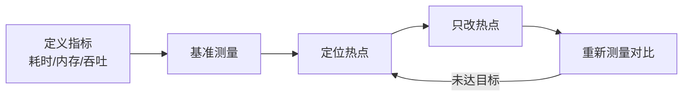

性能优化的第一步不是改代码,而是回答"时间花在哪"。凭直觉猜热点,十有八九会改错地方。Python 标准库自带两个层次的测量工具:`timeit` 测小段代码,`cProfile` 测整个程序的函数调用。

## 先测量再优化

优化的收益来自热点:少数函数占用大部分时间。流程应该是:



没有基线的优化无法验证,也容易引入回归。先把"当前多慢、目标多快"写下来。

## timeit:测微基准

```python
import timeit

timeit.timeit("'-'.join(str(x) for x in range(100))", number=10_000)
```

命令行更方便:

```bash
python -m timeit -n 10000 -s "xs=list(range(100))" "sum(xs)"
```

- `number` 是执行次数,结果除以次数得到单次耗时;
- `-s` 设置初始化代码,初始化不计入计时;
- 默认会选重复次数并报告最小值,最小值比平均值更能反映真实开销;
- 测的是"代码片段",不要在里面做 IO、随机、依赖外部状态的操作。

使用 `time.time()` 粗测的问题:精度受系统时钟影响、单次测量噪声大、容易把初始化算进去。微基准用 timeit,整体流程用 cProfile。

## cProfile:函数级热点

```python
import cProfile, pstats

cProfile.run("main()", "prof.out")

stats = pstats.Stats("prof.out")
stats.sort_stats("cumulative").print_stats(20)
```

```bash
python -m cProfile -o prof.out main.py
python -m pstats prof.out
```

关键列:

| 列 | 含义 |
| --- | --- |
| `ncalls` | 调用次数 |
| `tottime` | 函数自身耗时,不含子调用 |
| `cumtime` | 含子调用的累计耗时 |
| `percall` | 每次调用平均耗时 |

`tottime` 高说明函数内部本身慢;`cumtime` 高但 `tottime` 低说明它在等待子调用,真正的热点在更下层。按 `tottime` 排序找自身慢的函数,按 `cumtime` 看调用链。

cProfile 有固定开销(每次函数调用都记录),适合找相对热点,不适合测微秒级差异。被测函数太小时,结果里的 profile 开销会失真。

## 更细的定位

- **line_profiler**:逐行统计耗时,定位到函数里的具体语句;
- **py-spy**:无需改代码,采样运行中的进程,适合线上与长驻服务;
- **memory_profiler / tracemalloc**:内存版的分析,下一篇展开;
- **perf / py-spy record**:生成火焰图,看调用栈占比。

```bash
py-spy top --pid 12345
py-spy record -o profile.svg -- python app.py
```

线上服务不方便停,采样工具比插桩更合适。它们看到的是真实分布,但精度低于确定性 profiler。

## 常见误区

- **优化没测过的代码**:猜测的热点通常不是热点;
- **只看总耗时**:不知道是 CPU、IO 还是锁等待;
- **在 profiler 下比较微基准**:profile 开销会放大函数调用多的写法;
- **忽略输入规模**:小数据下快的算法,大数据下可能更慢;
- **一次只测一次**:噪声导致结论反转,多次测量取稳定值;
- **把缓存预热算进基准**:第一次调用与稳定状态差别很大。

## 基准的写法

```python
import timeit

setup = "from __main__ import parse; text = 'x' * 10_000"
t1 = min(timeit.repeat("parse(text)", setup=setup, repeat=5, number=1000))
```

`repeat` 多次取最小值,减少系统噪声影响。比较两个实现时,同样的输入、同样的环境、交替测量,避免 CPU 频率漂移只影响其中一方。

## 小结

- 优化前先建立基线并定位热点,不要凭直觉改代码;
- timeit 测小段代码,`repeat` 取最小值降低噪声;
- cProfile 找函数级热点,`tottime` 看自身,`cumtime` 看调用链;
- line_profiler、py-spy 分别做逐行与线上采样;
- 同一基准下对比改动,避免 profiler 开销干扰结论。
