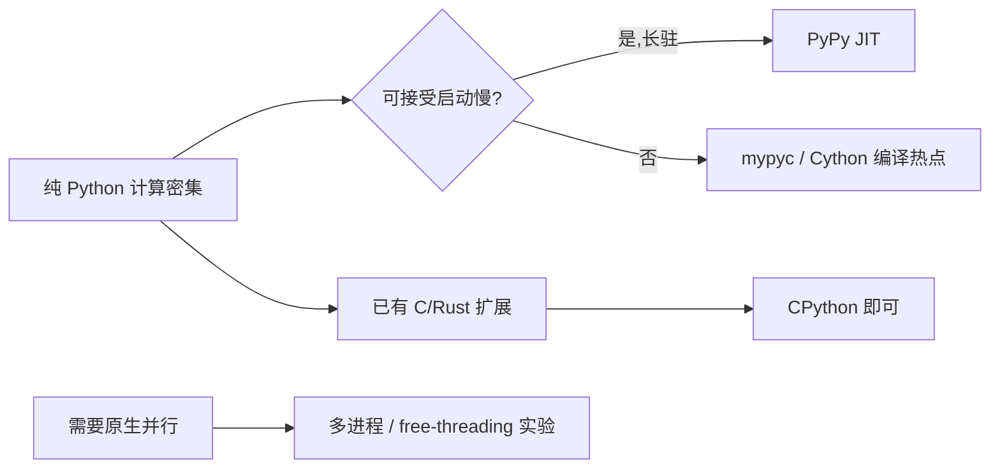

当算法与写法都优化过,瓶颈仍在解释执行开销时,才轮到换运行时或加编译层。这一步改动大、约束多,应该放在最后。

## CPython:默认选择

标准构建的 CPython 是生态与兼容性的基准:C 扩展、工具链、部署方案都以它为前提。除非基准明确显示解释开销是主因,否则不要换。



## PyPy:JIT

PyPy 用 JIT 把热点循环编译成机器码,长时间运行的纯 Python 计算通常比 CPython 快数倍。

适合:

- 长驻服务、批处理、算法模拟;
- 纯 Python 代码为主,依赖都是纯 Python 包;
- 能接受较慢的启动与更高的内存占用。

不适合:

- 短生命周期脚本:JIT 还没预热就结束;
- 依赖大量 C 扩展的栈(numpy、pandas):PyPy 的 C API 兼容层有额外成本,可能比 CPython 更慢;
- 需要精确的 CPython 行为(如依赖 `sys.getrefcount`、`gc` 细节)。

迁移前必须用真实负载跑基准,不要只看宣传数字。

## mypyc / Cython:编译热点

两者都能把 Python 代码编译成 C 扩展,减少解释开销:

```python
# mypyc:依赖完整类型注解
def total(xs: list[int]) -> int:
    s = 0
    for x in xs:
        s += x
    return s
```

```bash
mypyc module.py            # 生成扩展模块
```

```cython
# Cython:可以用 cdef 声明 C 类型
cpdef long total(list xs):
    cdef long s = 0
    cdef long x
    for x in xs:
        s += x
    return s
```

- mypyc 更贴近普通 Python,靠注解优化,适合"已经写好类型"的代码;
- Cython 需要学习额外语法,但能精确控制类型与内存,优化空间更大;
- 只编译热点模块,不要全项目编译:构建复杂度与调试难度都会上升。

编译后的模块调试信息变少,性能问题要从源码层排查。团队需要接受新的构建流程。

## Rust / C 扩展

计算量极大、且能划出清晰边界时,把内核写成原生扩展:

- Rust:`pyo3` + `maturin`,内存安全,工具链现代;
- C/C++:CPython C API 或 `pybind11`,生态成熟,但手工引用计数容易出错;
- 边界设计:一次调用处理一批数据,避免在 Python 与原生之间频繁来回;
- 释放 GIL:长时间计算中释放 GIL,才能真正并行。

原生扩展的维护成本最高:跨平台编译、ABI 兼容、发布 wheel 都要额外投入。只有在热点稳定、收益明确时才值得。

## free-threading

PEP 703 提供无 GIL 的实验构建(3.13 起),用偏向锁与延迟引用计数替代全局锁。现状:

- 单线程性能低于标准构建;
- C 扩展需要适配线程安全;
- 生态兼容性仍在完善。

生产环境继续用标准构建,把"多核并行"交给多进程。free-threading 成熟后再评估。

## 选型方法

1. 用 profile 确认瓶颈是解释执行,不是 IO、算法或锁;
2. 估算收益上限:纯 Python 计算的理论加速空间有限;
3. 小范围原型验证:只改一个热点模块,在真实负载下对比;
4. 评估维护成本:构建、调试、发布、依赖兼容;
5. 收益不明确时,回到算法与架构层面。

| 场景 | 选择 |
| --- | --- |
| 一般业务 | CPython |
| 长驻纯 Python 计算 | PyPy(先验证依赖) |
| 已类型化的热点模块 | mypyc |
| 需要 C 级控制 | Cython |
| 极重计算内核 | Rust / C 扩展 |
| 需要多核 | 多进程 |

## 常见问题

- **只看微基准换运行时**:真实负载下可能没有收益;
- **PyPy 上跑 numpy 密集代码**:C 扩展兼容层反而拖慢;
- **全项目 mypyc 编译**:构建时间与调试成本失控;
- **原生扩展频繁跨边界调用**:调用开销吃掉计算收益;
- **在扩展里不释放 GIL**:多线程仍无法并行;
- **忽略部署复杂度**:目标环境能否编译、wheel 是否覆盖。

## 小结

- CPython 是默认,换运行时必须有基准依据;
- PyPy 适合长驻纯 Python 计算,依赖 C 扩展时要谨慎;
- mypyc / Cython 编译热点模块,前者靠注解,后者可精细控制类型;
- Rust / C 扩展用于极重计算,注意边界设计与 GIL 释放;
- free-threading 仍实验,生产的多核并行仍以多进程为主。
