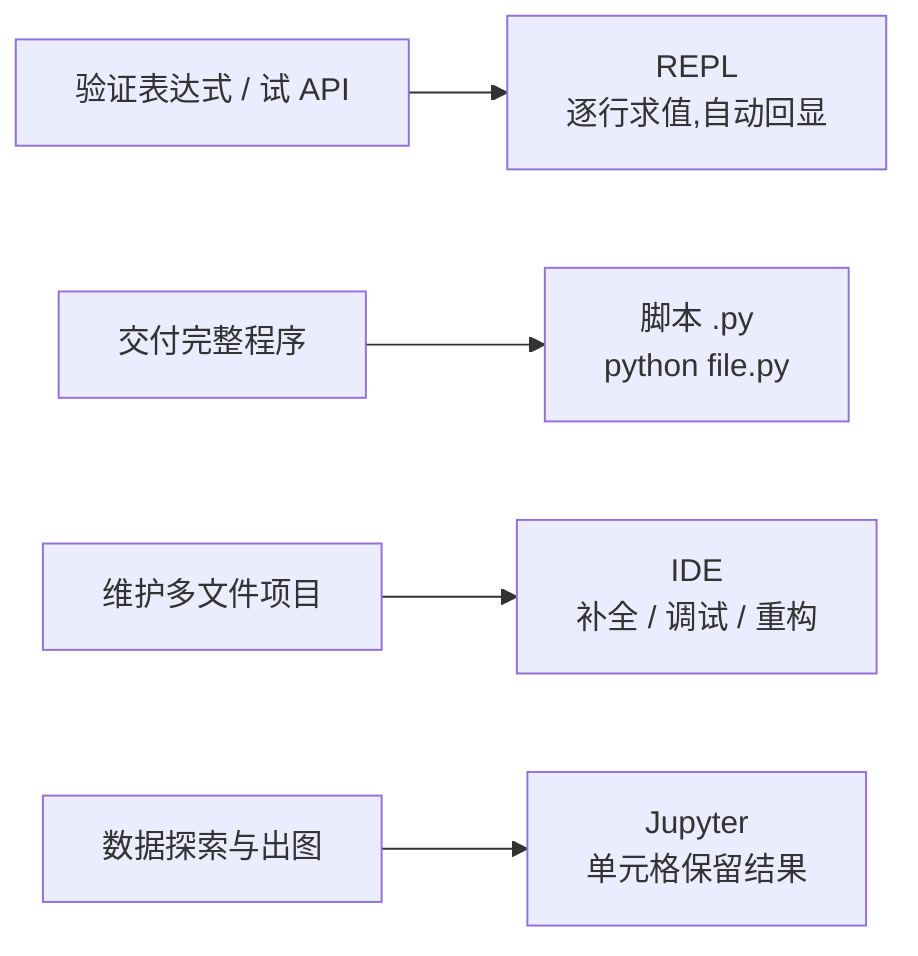

写 Python 有三种场所:交互式解释器(REPL)、脚本文件、集成环境(IDE)。它们不是优劣关系,而是对应不同任务:验证一个表达式用 REPL,交付一个程序用脚本,维护一个项目用 IDE。

## REPL:逐行求值

终端输入 `python`(或 `python3`)进入交互环境,提示符 `>>>`:

```python
>>> 2 + 3
5
>>> s = "abc"
>>> s.upper()
'ABC'
>>> exit()
```

特点:

- 每个表达式求值后**自动回显**结果(字符串带引号),这与 print 不同:print 输出的是字符串内容,不带引号;
- 适合验证 API 行为、试一个切片、看一个对象的类型;
- 多行块(函数/循环)输入后需空行结束;
- 退出:exit() 或 Ctrl-D(macOS/Linux)/ Ctrl-Z 回车(Windows)。

注意:REPL 里的状态只活在本次会话,关掉即消失;它不是保存代码的地方。

## 脚本:完整程序

把代码写进 .py 文件,`python hello.py` 执行。脚本与 REPL 的关键差别:

- 脚本中表达式**不会自动回显**,要输出必须 print;
- 脚本有 `__name__ == "__main__"`(第 8 章),可区分"被运行"与"被导入";
- 文件默认 UTF-8;源码含中文无需声明编码(Python 3 默认)。

缩进是语法:同一代码块用一致缩进(约定 4 空格),混用 tab 与空格会报 TabError。

## IDE:项目级工具

VS Code(装 Python 扩展)或 PyCharm:

- **解释器选择**:把项目指向某个 venv 的 python,补全与运行才用对环境;
- 补全与跳转:基于类型提示与静态分析(第 8 章);
- 调试:断点、单步、变量查看,比 print 排查高效;
- 集成终端、测试运行、格式化(ruff/black)。

选型:轻量与多语言混写选 VS Code;纯 Python 大项目、要深度重构选 PyCharm。两者都免费档够用。

## Jupyter:数据探索

`pip install jupyterlab` 后 `jupyter lab`,浏览器里按**单元格**执行,结果(表格/图)留在文档里。适合数据分析与教学演示,不适合交付服务代码(状态隐式、执行顺序可乱)。

## 怎么选



| 任务 | 场所 |
| --- | --- |
| 试一个表达式/API | REPL |
| 写一个可重复运行的程序 | 脚本 |
| 维护多文件项目 | IDE |
| 数据探索与出图 | Jupyter |

## 小结

- REPL 逐行求值自动回显,状态不持久;print 与回显不同;
- 脚本不回显、有 __main__、默认 UTF-8;缩进是语法;
- IDE 提供解释器绑定/补全/调试/重构,VS Code 与 PyCharm 按场景选;
- Jupyter 面向探索,不用于交付;
- 按任务切换场所,而非只用一种。

下一篇给出整份知识库的阅读路线。
