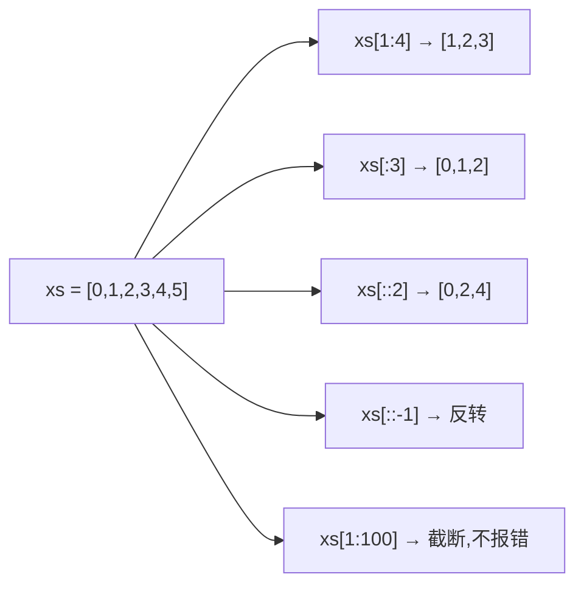

切片与解包是 Python 序列操作的两把利器,也是越界、拷贝、数量匹配三类错误的高发区。这一篇把语义边界讲清。

## 切片:[start:stop:step]

```python
xs = [0, 1, 2, 3, 4, 5]
xs[1:4]      # [1, 2, 3]  含头不含尾
xs[:3]       # [0, 1, 2]  省略 start=0
xs[3:]       # [3, 4, 5]  省略 stop=末尾
xs[::2]      # [0, 2, 4]  步长 2
xs[::-1]     # [5, 4, 3, 2, 1, 0]  反转
xs[-3:]      # [3, 4, 5]  负索引从尾起
xs[1:100]    # [1, 2, 3, 4, 5]  越界截断,不报错
```

与索引的关键差别:**索引越界抛 IndexError,切片越界截断**。`xs[10]` 报错,`xs[10:20]` 得 []。

slice 对象可复用:`last3 = slice(-3, None); xs[last3]`。

## 切片是浅拷贝,且列表切片可赋值



`ys = xs[:]` 新建列表,元素引用共享(浅拷贝,第 3.5 篇)。改 ys 的外层不影响 xs,改共享的内层对象双方可见。

列表支持**切片赋值**(原地改长度):

```python
xs[1:3] = [9, 9, 9]   # 替换区间,长度可变
xs[::2] = [0, 0, 0]   # 带步长时长度必须匹配
del xs[1:3]           # 删除区间
```

元组/字符串不可变,切片只得新对象,不能切片赋值。

## 解包赋值

```python
a, b = 1, 2            # 右侧先整体求值成元组,再解包
a, b = b, a            # 交换,无需临时变量
first, *rest = [1, 2, 3, 4]    # first=1, rest=[2,3,4]
*init, last = [1, 2, 3, 4]     # init=[1,2,3], last=4
head, *mid, tail = [1, 2, 3, 4, 5]
```

星号目标收集"剩余"为**列表**(即使源是元组/生成器)。一个解包式里最多一个星号。

数量必须匹配(星号除外):`a, b = [1, 2, 3]` 抛 ValueError: too many values to unpack。函数返回多值、enumerate/zip/items 的循环变量都是解包。

嵌套解包:`(a, b), c = (1, 2), 3`。忽略某位用 `_`:`_, y = point`。

## 解包与迭代协议

解包右侧可以是任何可迭代对象(生成器、文件行),不要求是序列:`a, b = (i for i in range(2))` 合法。但星号收集会**耗尽**生成器剩余部分,注意一次性。

## 易错点清单

- 切片含头不含尾,`xs[1:3]` 只有两个元素;
- 索引越界报错、切片越界截断,二者不要混;
- `xs[:]` 是浅拷贝,嵌套可变对象仍共享;
- 带步长的切片赋值长度必须相等;
- 解包数量不匹配抛 ValueError,星号只能一个;
- `[::-1]` 反转得新对象,列表就地反转用 reverse()。

## 小结

- 切片 [start:stop:step],含头不含尾,越界截断;负步长反转;
- 切片是浅拷贝;列表可切片赋值/删除,步长赋值长度须匹配;
- 解包:右侧整体求值再分配;星号收集剩余为列表,最多一个;
- 交换 a,b=b,a;嵌套解包;_ 忽略;
- 解包接受任何可迭代对象,星号会耗尽生成器。

下一篇讲推导式:把"循环+append"压缩成一行。
