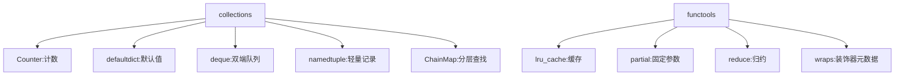

标准库的两组"常用而容易被忽略"的模块:`collections` 提供更适合具体场景的容器,`functools` 提供处理函数对象的高阶工具。用对它们,能少写不少样板代码。

## Counter:计数

```python
from collections import Counter

c = Counter("abracadabra")
c["a"]           # 5
c.most_common(2) # [('a', 5), ('b', 2)]

c.update(["a", "z"])
c.total()        # 3.10+ 元素总数
```

Counter 是 dict 的子类,缺失键返回 0,不抛 KeyError。`most_common(n)` 按计数降序取前 n 个,统计词频、错误码分布、投票结果时直接可用。两个 Counter 还能做 `+`、`-`、`&`、`|` 的集合式运算。

## defaultdict:带默认值

```python
from collections import defaultdict

groups = defaultdict(list)
for word in words:
    groups[word[0]].append(word)

counts = defaultdict(int)
for x in items:
    counts[x] += 1
```

`defaultdict(list)` 在访问缺失键时自动插入 `list()`,省掉 `if key not in d` 的分支。构造参数是"无参可调用对象",所以 `defaultdict(int)` 得到 0,`defaultdict(set)` 得到空集合。

注意:访问即插入。只想查询、不想改字典时,用 `d.get(key)` 或 `key in d`,否则会凭空多出键。

## deque:双端队列

```python
from collections import deque

q = deque(maxlen=3)
q.append(1); q.append(2); q.append(3); q.append(4)
list(q)          # [2, 3, 4],超出 maxlen 自动丢左端

q.appendleft(0)
q.popleft()
q.rotate(1)
```

`deque` 两端插入删除都是 O(1),list 在头部插入是 O(n)。滑动窗口、最近 N 条日志、广度优先搜索的队列都用它。`maxlen` 让"只保留最近 N 个"免去手动裁剪。

## namedtuple:带字段名的元组

```python
from collections import namedtuple

Point = namedtuple("Point", ["x", "y"])
p = Point(1, 2)
p.x, p.y        # 1, 2
x, y = p        # 仍可解包
p._asdict()     # {'x': 1, 'y': 2}
```

它是元组的子类,不可变、可解包、有字段名,适合轻量记录。需要默认值、方法或可变字段时,用 dataclass(第 5 章)更合适。两者对比:命名元组更省内存、更像值;dataclass 更灵活、能写校验。

## OrderedDict 的定位

3.7 起普通 dict 保证插入顺序,OrderedDict 的"记住顺序"已不再是优势。它仍有少数差异:

- `move_to_end(key)`:把键移到末尾,做 LRU 缓存时有用;
- `popitem(last=False)`:从头部弹出;
- 相等比较考虑顺序,普通 dict 不考虑。

除非需要这些操作,新代码直接使用 dict。

## ChainMap:多层查找

```python
from collections import ChainMap

defaults = {"theme": "light", "lang": "zh"}
user = {"theme": "dark"}
cfg = ChainMap(user, defaults)

cfg["theme"]     # 'dark',前面的优先
cfg["lang"]      # 'zh',回退到 defaults
```

适合"用户配置覆盖默认配置"这类分层查找。写入只作用于第一层,不会改到默认值。



## functools.lru_cache

```python
from functools import lru_cache

@lru_cache(maxsize=128)
def fib(n: int) -> int:
    return n if n < 2 else fib(n - 1) + fib(n - 2)
```

按参数缓存返回值,参数必须可哈希。`maxsize=None` 表示不限制(等价于 `cache`),但要注意内存;`typed=True` 会把 `1` 与 `1.0` 视为不同参数。

`lru_cache` 不提供失效接口,只有 `cache_clear()` 整体清空。依赖外部状态(时间、数据库)的函数不要缓存,否则返回过期结果。

## partial、reduce 与 cmp_to_key

```python
from functools import partial, reduce, cmp_to_key

to_binary = partial(int, base=2)
to_binary("1010")        # 10

reduce(lambda a, b: a + b, [1, 2, 3], 0)     # 6

sorted(words, key=cmp_to_key(compare_versions))
```

- `partial` 固定部分参数,生成新可调用对象,适合回调与配置化调用;
- `reduce` 把二元函数累积到单个值,可读性通常不如显式循环或 `sum`/`max`;
- `cmp_to_key` 把老式比较函数适配成 `key` 函数,只有在对接旧代码时才需要。

## 使用建议

- 统计频率先想 `Counter`,不要手写 dict 累加;
- 聚合到列表/集合/计数时用 `defaultdict`,但要清楚"访问即插入";
- 队列与滑动窗口用 `deque`,别用 list 的 `pop(0)`;
- 轻量不可变记录用 namedtuple,需要方法或校验用 dataclass;
- 纯函数且参数可哈希时才加缓存,缓存键要覆盖所有影响结果的输入。

## 小结

- `Counter` 处理计数,`defaultdict` 处理分组聚合,`deque` 处理两端操作;
- `namedtuple` 是带字段名的元组,`OrderedDict` 仅剩少数特殊操作有意义;
- `ChainMap` 实现分层配置查找;
- `lru_cache` 只缓存纯函数,`partial` 与 `cmp_to_key` 解决参数与比较适配;
- 选容器先看操作的复杂度与语义,再考虑代码量。
