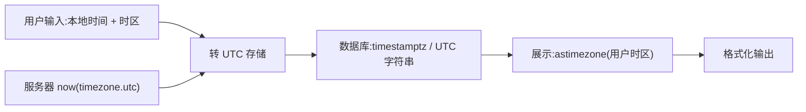

时间问题大多不是"怎么格式化",而是"这个时间属于哪个时区"。Python 把 datetime 分成两类:不带时区的 naive 和带时区的 aware。混用这两类,是跨时区系统里最常见的 bug 来源。

## naive 与 aware

```python
from datetime import datetime, timezone

naive = datetime(2026, 11, 23, 12, 0)                 # 不知道是哪个时区
aware = datetime(2026, 11, 23, 12, 0, tzinfo=timezone.utc)

naive.tzinfo      # None
aware.tzinfo      # datetime.timezone.utc
naive == aware    # TypeError? 不会,但比较结果没有意义
```

两个 naive 时间相减会得到 timedelta,看起来能用,但它默认两者在同一时区。一旦一方实际是 UTC、另一方是本地时间,差值就错了。

规则:**进入系统边界时确定时区,内部统一用 UTC 存储,展示时再转本地时区。**

## 获取当前时间

```python
from datetime import datetime, timezone

now_utc = datetime.now(timezone.utc)          # 推荐:带 UTC 时区
now_local = datetime.now().astimezone()       # 本地时区的 aware 时间
```

`datetime.utcnow()` 返回 naive 时间,已明确不推荐,新代码不要用。`now(timezone.utc)` 得到 aware 对象,后续转换与比较都不会歧义。

服务器时区经常是 UTC 或某个默认值,`datetime.now()` 不带时区时,含义取决于部署环境。业务代码不要依赖 `now()` 的隐式语义。

## 时区转换

```python
from zoneinfo import ZoneInfo

shanghai = ZoneInfo("Asia/Shanghai")
local = now_utc.astimezone(shanghai)          # 同一时刻,换表示
local.hour                                     # 已经是东八区的小时
```

`astimezone` 不改变时间点,只改变表示。`ZoneInfo` 使用 IANA 时区名(`Asia/Shanghai`、`America/New_York`),能正确处理夏令时;固定偏移用 `timezone(timedelta(hours=8))`,但它不知道 DST 规则,跨地区业务不要用。



## 格式化与解析

```python
dt = datetime(2026, 11, 23, 12, 30, tzinfo=timezone.utc)

dt.isoformat()                     # '2026-11-23T12:30:00+00:00'
datetime.fromisoformat("2026-11-23T12:30:00+08:00")

dt.strftime("%Y-%m-%d %H:%M")      # '2026-11-23 12:30'
datetime.strptime("2026-11-23", "%Y-%m-%d")
```

- `isoformat()` 是跨系统交换的默认选择,时区偏移一并保留;
- `fromisoformat` 在 3.11 起支持更多格式,但仍不如第三方 `dateutil` 宽松;
- `strftime` 依赖系统 locale 的地方(月份名、星期名)在不同机器上输出可能不同,接口输出避免使用;
- `strptime` 解析失败抛 ValueError,不要用它做"宽松猜测",输入格式要明确约定。

`%Y-%m-%d %H:%M:%S` 这套格式适合日志与人工查看;机器之间用 ISO 8601 或 Unix 时间戳。

## timedelta 与时间戳

```python
from datetime import timedelta

deadline = now_utc + timedelta(days=7, hours=2)
elapsed = now_utc - start
elapsed.total_seconds()
```

`timedelta` 支持加减与比较,但只表示"时长",不带时区。跨 DST 的"加一天"用 `timedelta(days=1)` 会得到 24 小时,而不是"同一本地时刻的第二天";需要按日历推进时用 `dateutil.relativedelta` 或显式处理时区。

时间戳:

```python
ts = dt.timestamp()                       # 秒,float
datetime.fromtimestamp(ts, timezone.utc)  # 注意必须给 tz
```

`timestamp()` 对 naive 时间会按本地时区解释,结果依赖运行环境;`fromtimestamp` 不给 tz 会返回本地 naive 时间。两端必须显式指定时区,否则同一秒数在不同机器上转出不同时间。

数据库存储优先用带时区类型(PostgreSQL 的 `timestamptz`),或统一存 UTC;不要存"本地时间字符串",除非同时存了时区名。

## 常见问题

- **UTC 与本地时间混存**:同一列里既有 UTC 又有本地时间,排序与查询全错;
- **naive 与 aware 比较**:3.x 中比较会抛 TypeError,早期版本行为不一致,不要依赖;
- **用固定偏移代替时区名**:夏令时切换后偏移变了,固定偏移不跟随;
- **用 `utcnow()`**:返回 naive,已不推荐;
- **把时间当字符串比较**:格式不统一时字典序不等于时间序,先解析再比较;
- **依赖服务器本地时区**:容器默认通常是 UTC,迁移后行为变化。

## 小结

- 区分 naive 与 aware,内部统一 UTC,边界处确定时区;
- 当前时间用 `now(timezone.utc)`,不要用 `utcnow()`;
- 时区用 `ZoneInfo` 与时区名,固定偏移不处理夏令时;
- 交换用 ISO 8601 或时间戳,展示用 `strftime` 并固定格式;
- 时间戳与 `fromtimestamp` 两端都要显式给时区。
