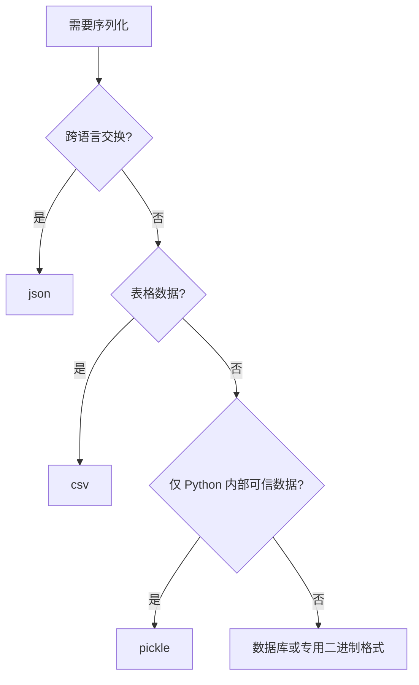

序列化把内存对象变成可存储、可传输的字节流,反序列化再还原。json 面向跨语言交换,csv 面向表格,pickle 面向 Python 内部对象。三者用途不同,不能互相替代。

## json 的类型映射

| Python | JSON |
| --- | --- |
| dict | object |
| list / tuple | array |
| str | string |
| int / float | number |
| True / False | true / false |
| None | null |

tuple 会被序列化成数组,反序列化回来是 list,类型信息丢失。datetime、Decimal、自定义类都不在映射表里,直接 `dumps` 会抛 TypeError。

```python
import json

data = {"name": "Ada", "tags": ["py", "ml"], "active": True}
text = json.dumps(data, ensure_ascii=False, indent=2)
back = json.loads(text)
```

```json
{
  "name": "Ada",
  "tags": ["py", "ml"],
  "active": true
}
```

- `ensure_ascii=False`:保留中文,否则输出 `\uXXXX`;
- `indent=2`:缩进便于阅读,线上传输可省略;
- `sort_keys=True`:键排序,便于 diff;
- `separators=(",", ":")`:紧凑格式,减少体积。

## 自定义对象的序列化

方式一:转换后再 dumps。

```python
from dataclasses import asdict

json.dumps(asdict(user), ensure_ascii=False)
```

方式二:用 `default` 钩子处理不支持的类型。

```python
from datetime import datetime, date

def encode(obj):
    if isinstance(obj, (datetime, date)):
        return obj.isoformat()
    if isinstance(obj, Decimal):
        return str(obj)
    raise TypeError(f"不支持的类型: {type(obj).__name__}")

json.dumps(payload, default=encode, ensure_ascii=False)
```

`default` 只对"json 不认识的对象"调用,返回可序列化的值。金额用字符串编码,避免 float 精度损失;时间用 ISO 8601,跨语言可读。

反序列化时用 `object_hook` 还原成对象:

```python
def decode(d):
    if "created_at" in d:
        d["created_at"] = datetime.fromisoformat(d["created_at"])
    return d

json.loads(text, object_hook=decode)
```

## 文件读写

```python
from pathlib import Path

path = Path("config.json")
path.write_text(json.dumps(cfg, ensure_ascii=False, indent=2), encoding="utf-8")
cfg = json.loads(path.read_text(encoding="utf-8"))

# 或
with path.open("w", encoding="utf-8") as f:
    json.dump(cfg, f, ensure_ascii=False, indent=2)
```

`dump`/`load` 直接操作文件对象,`dumps`/`loads` 操作字符串。写文件时显式 `encoding="utf-8"`,否则仍然受平台默认编码影响。

json 没有"追加"语义:修改后要整体重写。需要并发写入时先写临时文件再 `os.replace`,避免读到半截内容。

## csv:表格

```python
import csv

with open("users.csv", newline="", encoding="utf-8") as f:
    for row in csv.DictReader(f):
        print(row["name"], row["age"])
```

```python
with open("out.csv", "w", newline="", encoding="utf-8") as f:
    writer = csv.DictWriter(f, fieldnames=["name", "age"])
    writer.writeheader()
    writer.writerows(rows)
```

要点:

- **必须 `newline=""`**:否则 Windows 上会多出空行,这是 csv 模块的硬性要求;
- `DictReader`/`DictWriter` 按表头读写,比下标更稳;
- 含逗号、引号、换行的字段由 csv 模块自动加引号,不要手工拼接;
- 中文用 `utf-8`,给 Excel 打开时可能需要 `utf-8-sig`(带 BOM);
- 数值字段读出来是字符串,需要显式 `int()`/`float()` 转换。

csv 适合结构简单的表格。嵌套结构、类型多样、需要跨语言时用 json;数据量大时再考虑 Parquet 等列式格式,不在标准库范围内。

## pickle:Python 专用

```python
import pickle

payload = pickle.dumps(obj)
obj = pickle.loads(payload)
```

pickle 能序列化几乎任意 Python 对象,包括类实例、函数引用、循环引用。代价是:

- **只能 Python 读**,跨语言不通;
- **与类定义强绑定**:类改了模块路径或字段,pickle 可能无法还原;
- **不安全**:反序列化时会执行类与 `__reduce__` 中的逻辑,加载不可信数据等于执行任意代码。

```text
# 绝对不能这样
data = pickle.loads(untrusted_bytes)
```

pickle 只用于"自己产生、自己消费"的缓存、进程间传输、多进程任务参数。对外接口、配置、持久数据一律用 json 或数据库。

## 选型



| 需求 | 选择 |
| --- | --- |
| 跨语言 API、配置 | json |
| 表格数据、Excel 交换 | csv(必要时 xlsx 库) |
| Python 内部缓存、进程间传对象 | pickle(仅可信数据) |
| 二进制高效存储 | 第三方库(Parquet、MessagePack) |

## 小结

- json 的类型映射有限,tuple 变 list,自定义类型用 `default` 与 `object_hook`;
- 中文用 `ensure_ascii=False`,文件读写显式 utf-8;
- csv 必须 `newline=""`,`DictReader`/`DictWriter` 按表头更稳;
- pickle 只能用于可信的 Python 内部数据,不可加载不可信输入;
- 选型按"跨语言、表格、内部对象"三类需求划分。
