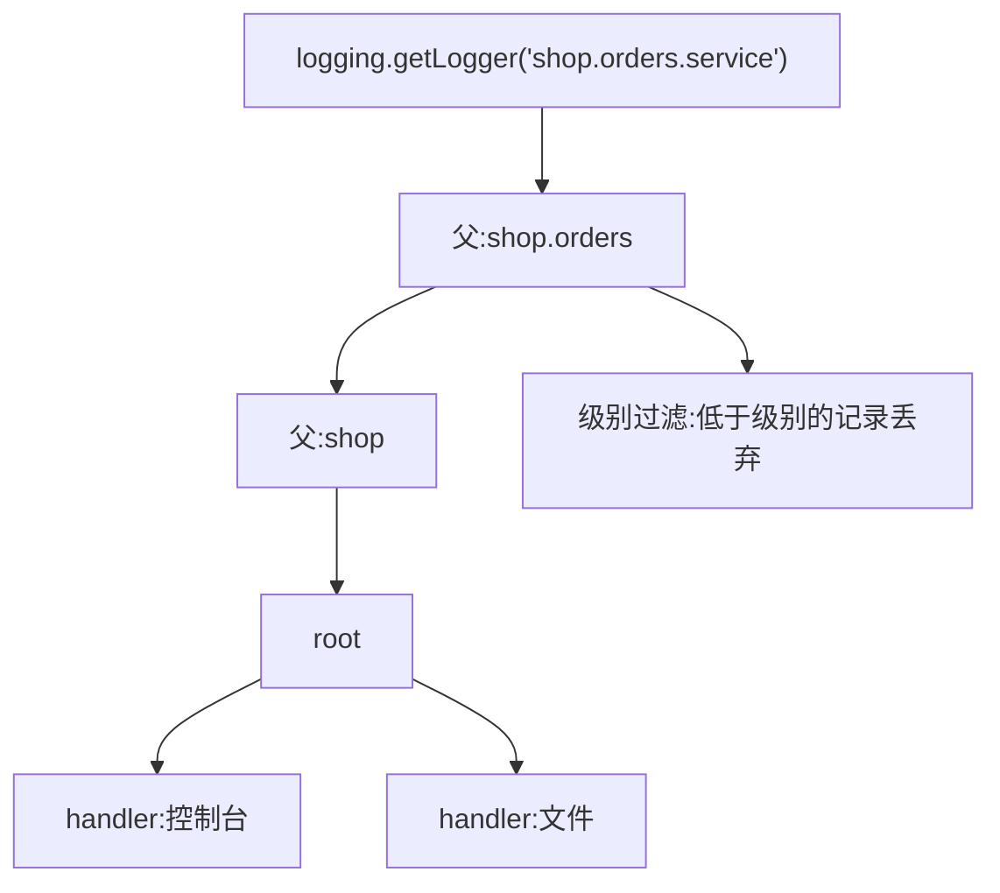

`print` 会把输出混进 stdout,无法分级、无法按模块过滤、也无法在部署时切换目标。`logging` 提供级别、命名空间与输出端三条控制维度;`argparse` 负责把命令行输入变成结构化参数。两者是命令行工具与服务的标准配置。

## logging 的级别

| 级别 | 数值 | 用途 |
| --- | --- | --- |
| DEBUG | 10 | 调试细节,默认不输出 |
| INFO | 20 | 正常运行信息 |
| WARNING | 30 | 可恢复的异常情况 |
| ERROR | 40 | 功能失败 |
| CRITICAL | 50 | 程序无法继续 |

设置级别为 INFO 时,DEBUG 被过滤,INFO 及以上输出。级别是对"重要性"的声明,不是对"是否打印"的开关。

```python
import logging

log = logging.getLogger(__name__)
log.debug("缓存命中 %s", key)
log.info("处理完成,共 %d 条", count)
log.warning("配置缺失,使用默认值")
log.error("请求失败: %s", err)
log.exception("未预期异常")        # 仅在 except 块内使用
```

延迟格式化:`log.info("x=%s", x)` 只在真正输出时格式化,比 f-string 先拼接更省;`log.exception` 自动附加当前异常堆栈,不要在 except 之外调用。

## logger 的层级与传播

logger 按点号分级:`shop.orders.service` 是 `shop.orders` 的子级,`shop.orders` 又是 `shop` 的子级。子级没有自己的 handler 时,记录向父级传播,直到 root。



`getLogger(__name__)` 让每条记录自动带上模块名,`%(name)s` 在格式里就能看出是哪个模块输出的。这也是"库代码不要配置 root"的原因:库只声明 logger,把输出目标留给应用决定。

## handler 与 formatter

```python
import logging
from logging.handlers import RotatingFileHandler

handler = RotatingFileHandler("app.log", maxBytes=10_000_000, backupCount=5,
                              encoding="utf-8")
fmt = logging.Formatter("%(asctime)s %(levelname)s %(name)s %(message)s")
handler.setFormatter(fmt)

root = logging.getLogger()
root.setLevel(logging.INFO)
root.addHandler(handler)
root.addHandler(logging.StreamHandler())
```

- handler 决定"输出到哪里",可以同时挂控制台、文件、远端;
- formatter 决定"长什么样",常用字段:`%(asctime)s`、`%(levelname)s`、`%(name)s`、`%(message)s`;
- `RotatingFileHandler` 按大小轮转,`TimedRotatingFileHandler` 按时间轮转,避免日志无限增长;
- 文件 handler 也受编码影响,统一写 `encoding="utf-8"`。

用 `logging.basicConfig(level=..., format=...)` 做单 handler 的快速配置,项目里更常用 `dictConfig` 从配置字典统一初始化。

## 库与应用的分工

```python
# 库代码:只取 logger,不配置
log = logging.getLogger(__name__)

# 应用入口:配置一次
import logging.config
logging.config.dictConfig(LOG_CONFIG)
```

如果库代码调用 `basicConfig` 或 `addHandler(root)`,会污染使用方的日志配置,导致重复输出或格式错乱。约定是:库声明 `getLogger(__name__)`,应用在入口统一配置。

需要安静地处理预期异常时,用 `log.warning` 而不是 `log.exception`;需要排查未知异常时用 `log.exception`。日志里的异常必须带堆栈,`log.error(str(e))` 等于丢掉最重要的信息。

## argparse 基础

```python
import argparse

def build_parser():
    p = argparse.ArgumentParser(prog="mytool", description="示例工具")
    p.add_argument("input", help="输入文件")
    p.add_argument("-o", "--output", default="-", help="输出文件")
    p.add_argument("--limit", type=int, default=100)
    p.add_argument("--verbose", action="store_true")
    p.add_argument("--mode", choices=["fast", "safe"], default="safe")
    return p

args = build_parser().parse_args()
args.input, args.output, args.limit, args.verbose, args.mode
```

要点:

- 位置参数不带前缀,可选参数以 `-`/`--` 开头;
- `type=` 做转换,int 转换失败由 argparse 报错并退出;
- `action="store_true"` 生成布尔开关;
- `choices=` 限定取值,非法值自动报错;
- `default=` 设定缺省,`required=True` 强制必填。

`parse_args()` 失败时打印用法并以退出码 2 结束,不抛异常。需要在测试里捕获错误时用 `parse_args([])` 并捕获 SystemExit,或用 `exit_on_error=False`(3.9+)。

## 子命令

```python
p = argparse.ArgumentParser()
sub = p.add_subparsers(dest="cmd", required=True)

add = sub.add_parser("add", help="新增")
add.add_argument("name")

rm = sub.add_parser("remove", help="删除")
rm.add_argument("name")

args = p.parse_args()
if args.cmd == "add":
    ...
```

子命令让一个入口承载多套操作,`git`、`docker` 都是这种形态。每个子命令有自己的参数集,`dest` 用来判断走了哪个分支。

## 组合方式

```python
def main(argv=None):
    parser = build_parser()
    args = parser.parse_args(argv)
    logging.basicConfig(
        level=logging.DEBUG if args.verbose else logging.INFO,
        format="%(asctime)s %(levelname)s %(message)s",
    )
    run(args)

if __name__ == "__main__":
    raise SystemExit(main())
```

命令行参数控制日志级别、输出目标与运行模式,入口函数负责把它们落到具体配置上。测试时直接调用 `main(["--limit", "10"])`,不依赖真实命令行。

## 常见问题

- **print 与 logging 混用**:stdout 里既有业务输出又有日志,管道处理会出错;
- **库代码配置 root**:使用方的日志被覆盖;
- **只在 except 外用 `exception`**:没有堆栈,输出与 error 一样;
- **日志里拼 f-string**:即使级别过滤也会先格式化,量大时白白消耗;
- **argparse 的 `type=int` 报错后继续**:它默认直接退出,需要继续执行时改用 `type=` 自定义函数并捕获错误;
- **参数名与 dest 不一致**:`--output` 默认 dest 是 `output`,长选项有短横线时要注意转换。

## 小结

- logging 用级别、logger 层级与 handler 三条维度控制输出;
- 库代码只 `getLogger(__name__)`,应用在入口统一配置;
- handler 决定去向,formatter 决定格式,文件 handler 显式 utf-8;
- argparse 用 `type`/`choices`/`action` 表达参数约束,子命令承载多套操作;
- 命令行参数负责选择配置,入口函数负责应用配置。
