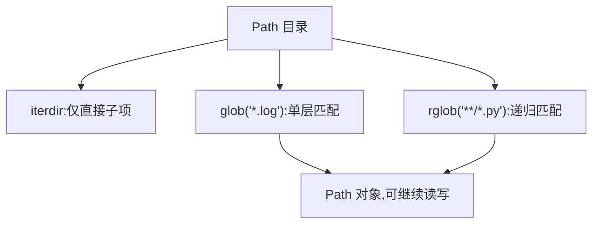

路径处理有两套 API:`os.path` 的字符串函数与 `pathlib` 的 Path 对象。新代码优先用 Path:拼接用 `/`、方法挂在对象上、跨平台分隔符由库处理。

## 构造与拼接

```python
from pathlib import Path

base = Path("data")
file = base / "raw" / "users.csv"     # data/raw/users.csv
file.name        # 'users.csv'
file.stem        # 'users'
file.suffix      # '.csv'
file.parent      # data/raw
file.parts       # ('data', 'raw', 'users.csv')
```

`/` 运算符拼接路径,比字符串加法安全:不会漏分隔符,也不会因平台不同出错。`Path("a") / "b"` 与 `Path("a") / Path("b")` 都可用。

```python
p = Path("logs/app.log")

p.is_absolute()      # False
p.resolve()          # 转成绝对路径并解析 .. 与符号链接
Path.home()          # 用户主目录
Path.cwd()           # 当前工作目录
```

`resolve()` 会访问文件系统解析符号链接与 `..`,路径不存在时在 3.6+ 默认不报错。需要"规范化但不解析链接"时用 `os.path.normpath` 或 `Path.absolute()`。

## 读写

```python
text = p.read_text(encoding="utf-8")
p.write_text("hello\n", encoding="utf-8")

data = p.read_bytes()
p.write_bytes(b"\x00\x01")
```

`read_text`/`write_text` 必须显式给 `encoding`。省略时用平台默认编码,Windows 上常是 GBK,同一份文件在 Linux 上就会读出乱码。二进制用 `read_bytes`/`write_bytes`。

需要逐行处理大文件时不要 `read_text` 整体读入,用流式读取:

```python
with p.open(encoding="utf-8") as f:
    for line in f:
        process(line.rstrip())
```

`Path.open` 的参数与内置 `open` 一致,返回文件对象,配合 `with` 自动关闭。

## 遍历目录

```python
for child in Path(".").iterdir():          # 直接子项
    print(child)

list(Path("src").glob("**/*.py"))          # 递归匹配
list(Path("src").rglob("*.py"))            # 同上,递归专用
```

- `iterdir()`:只列一层,返回 Path;
- `glob(pattern)`:`*` 匹配单层,`**` 递归,返回生成器;
- `rglob(pattern)`:等价于 `glob("**/" + pattern)`;
- 匹配结果只反映路径,不保证是文件,需要时再 `is_file()`。



## 创建、复制、删除

```python
p.mkdir(parents=True, exist_ok=True)       # 递归创建,已存在不报错
p.touch()                                  # 创建空文件或更新时间戳

import shutil
shutil.copy2(src, dst)                     # 复制内容 + 元数据
shutil.copytree(src_dir, dst_dir)          # 复制整棵目录
shutil.move(src, dst)                      # 移动/重命名
```

Path 提供 `mkdir`、`touch`、`rename`、`unlink`、`rmdir`;复制与递归删除要配合 `shutil`:

- `shutil.copy` 只复制内容,`copy2` 保留修改时间等元数据;
- `shutil.rmtree` 递归删除目录,不可恢复,调用前务必确认路径;
- `Path.unlink()` 只删文件,`Path.rmdir()` 只删空目录,非空会报 OSError。

```python
import tempfile, shutil

with tempfile.TemporaryDirectory() as tmp:
    work = Path(tmp) / "out.txt"
    work.write_text("ok", encoding="utf-8")
# 退出 with 后目录被删除
```

临时文件用 `tempfile`,不要手拼 `/tmp` 路径;退出时自动清理,异常路径也覆盖。

## 什么时候仍用 os / shutil

- 需要底层文件描述符、`os.stat` 的跨平台字段差异;
- 递归删除、复制、磁盘用量(`shutil.disk_usage`);
- 需要操作环境变量、进程(`os.environ`、`os.getpid`);
- 与 C 扩展或只接受字符串路径的接口交互,可以 `str(p)` 转换。

Path 对象可以直接传给大部分标准库与第三方库,不必转字符串。遇到只认 `str` 的 API 再转。

## 常见问题

- **省略 encoding**:跨平台乱码的第一原因;
- **用字符串拼路径**:`"a" + "\\" + "b"` 在 Windows 与 POSIX 上行为不同;
- **相对路径依赖当前工作目录**:服务与定时任务的 cwd 往往不是项目根,配置与资源路径应基于 `__file__` 或显式配置;
- **对不存在的路径调用 resolve 之外的严格方法**:`read_text` 会抛 FileNotFoundError,先判断或用 try;
- **rmtree 传错变量**:空字符串或根路径会删掉整个目录,删除前加断言与日志。

## 小结

- 新代码用 `pathlib.Path`,`/` 拼接,方法挂在对象上;
- 读写文本必须显式 `encoding`,大文件用流式读取;
- `iterdir` 一层,`glob`/`rglob` 按模式遍历;
- 创建用 `mkdir(parents=True, exist_ok=True)`,复制与递归删除用 `shutil`;
- 相对路径依赖 cwd,资源路径应显式配置。
