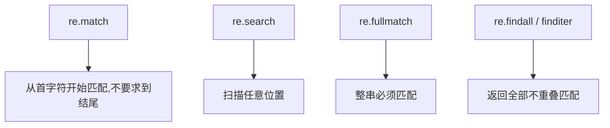

正则适合描述"有结构的文本":日志行、日期、标识符、简单的 URL。它不适合解析嵌套结构(HTML、JSON),那类问题用专门的解析器更可靠。Python 的 `re` 模块提供匹配、查找、替换、切分四类操作。

## 原始字符串

```python
pattern = r"\d+\.\d+"      # 正确:反斜杠原样传给正则引擎
bad = "\d+\.\d+"           # 字符串本身会处理转义,容易出错
```

正则里的 `\d`、`\w`、`\b` 与字符串转义冲突,统一用 `r""` 原始字符串,省去双重反斜杠。

## 常用元字符

| 写法 | 含义 |
| --- | --- |
| `.` | 任意字符(默认不含换行) |
| `\d` / `\w` / `\s` | 数字 / 单词字符 / 空白 |
| `[...]` | 字符集合,`[^...]` 取反 |
| `*` / `+` / `?` | 0+ / 1+ / 0 或 1 次 |
| `{m,n}` | m 到 n 次 |
| `^` / `$` | 行首 / 行尾(默认整串首尾) |
| `|` | 或 |
| `()` | 分组与捕获 |
| `(?P<name>...)` | 命名捕获组 |
| `(?=...)` / `(?!...)` | 前瞻,不消费字符 |

量词默认贪婪,尽量多吃;加 `?` 变非贪婪:`.*?`、`\d+?`。

## 四个匹配函数



```python
import re

re.match(r"\d+", "123abc")       # 从开头匹配,成功:123
re.search(r"\d+", "abc123")      # 任意位置查找,成功:123
re.fullmatch(r"\d+", "123")      # 整串必须匹配,成功
re.fullmatch(r"\d+", "123abc")   # None
```

| 函数 | 起点 | 结束要求 |
| --- | --- | --- |
| `match` | 必须开头 | 不要求到结尾 |
| `search` | 任意位置 | 不要求到结尾 |
| `fullmatch` | 必须开头 | 必须到结尾 |
| `findall` | 任意位置 | 返回所有不重叠匹配 |

校验"整串格式"时用 `fullmatch`,不要用 `match` 再加 `$`,后者对含换行的字符串容易出错。

## 预编译

```python
PHONE = re.compile(r"^1[3-9]\d{9}$")

if PHONE.fullmatch(text):
    ...
```

`re` 模块内部缓存最近使用的模式,但频繁匹配时显式 `compile` 更清楚,也能把命名常量集中管理。编译后的 `Pattern` 对象提供同名方法:`match`、`search`、`fullmatch`、`finditer`、`sub`。

注意 `compile` 返回对象的 `match` 与模块级 `re.match` 语义一致:从开头匹配。

## 分组

```python
m = re.search(r"(\d{4})-(\d{2})-(\d{2})", "日期 2026-11-23")
m.group(0)      # '2026-11-23' 整个匹配
m.group(1)      # '2026'
m.groups()      # ('2026', '11', '23')

m2 = re.search(r"(?P<y>\d{4})-(?P<m>\d{2})", "2026-11")
m2.group("y")   # '2026'
m2.groupdict()  # {'y': '2026', 'm': '11'}
```

命名分组让取值不依赖序号,模式调整时更稳。非捕获分组写 `(?:...)`,只用于组合,不占组号:

```python
re.match(r"(?:ab)+", "ababab").group()
```

## findall 与分组

`findall` 的行为随分组变化,是最容易踩的坑:

```python
re.findall(r"\d+", "a1 b22")              # ['1', '22'] 无分组:整个匹配
re.findall(r"(\d+)", "a1 b22")            # ['1', '22'] 一个分组:只返回组内容
re.findall(r"(\d)(\d)", "12 34")          # [('1','2'), ('3','4')] 多分组:元组
```

需要完整匹配又要分组时,用 `finditer` 逐个取 `match.group(0)` 与分组:

```python
for m in re.finditer(r"(\d+)-(\d+)", "1-2 3-4"):
    print(m.group(0), m.group(1), m.group(2))
```

## 替换与切分

```python
re.sub(r"\s+", " ", text)                       # 压缩空白
re.sub(r"(\w+)@(\w+)\.com", r"\2:\1", email)    # 用 \1 \2 引用分组
re.split(r"[,;]\s*", "a, b; c")                 # ['a', 'b', 'c']

def upper(m):
    return m.group(0).upper()
re.sub(r"[a-z]+", upper, text)                  # 回调替换
```

`sub` 的替换串里 `\1` 引用分组;需要复杂逻辑时传函数,函数接收 Match 对象并返回替换文本。

## 贪婪与回溯

```python
re.search(r"<.*>", "<a><b>").group()     # '<a><b>',贪婪吃到最后一个 >
re.search(r"<.*?>", "<a><b>").group()    # '<a>',非贪婪吃到第一个 >
```

灾难性回溯发生在多个可重叠量词嵌套时,例如 `(a+)+$` 匹配长串失败。输入稍长就可能耗时指数级增长:

```python
re.match(r"(a+)+$", "a" * 30 + "!")     # 极慢
```

防御手段:避免嵌套量词、用边界明确的字符类代替 `.`、限制输入长度、必要时设置超时(第三方 `regex` 库支持 timeout)。

## 常见问题

- **忘记 `r""`**:转义层层叠加,模式难以阅读;
- **用 `match` 当校验**:尾部剩余字符不会报错,应使用 `fullmatch`;
- **用正则解析 HTML / JSON**:嵌套与转义让正则迅速失控,用专门解析器;
- **`$` 与 `\Z` 的差异**:`$` 在末尾换行前也能匹配,严格结尾用 `\Z`;
- **分组改变 `findall` 结果**:需要整体匹配时用 `finditer`;
- **在拼接的模式里直接塞用户输入**:特殊字符要 `re.escape`,否则用户能注入正则语法。

## 小结

- 正则用原始字符串书写,元字符与量词构成模式;
- `match`/`search`/`fullmatch` 的起点与终点要求不同,校验用 `fullmatch`;
- 频繁匹配预编译,分组优先用命名组,只分组不捕获用 `(?:)`;
- `findall` 有分组时只返回组内容,需要整体匹配用 `finditer`;
- 避免嵌套量词,防范灾难性回溯。
