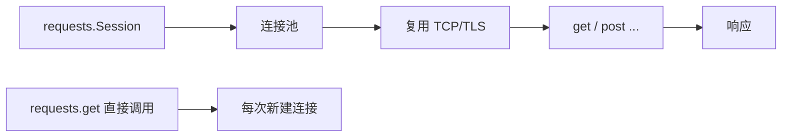

HTTP 客户端是后端与脚本最常用的依赖之一。`requests` 简单成熟,`httpx` 同时提供同步与异步接口。两者的核心概念一致:连接复用、超时、状态码判断与异常处理。

## requests 基础

```python
import requests

resp = requests.get("https://api.example.com/users", timeout=5)
resp.status_code          # 200
resp.json()
resp.text
resp.headers["content-type"]
```

```python
resp = requests.post(
    "https://api.example.com/users",
    json={"name": "Ada"},          # 自动设置 Content-Type 与序列化
    headers={"Authorization": "Bearer ..."},
    timeout=5,
)
resp.raise_for_status()            # 4xx/5xx 抛 HTTPError
```

要点:

- **必须设置 timeout**:默认没有超时,网络卡住会永久挂起;
- `json=` 参数自动序列化并设置头部,`data=` 发送表单或原始体;
- `raise_for_status()` 把 4xx/5xx 转成异常,不调用时状态码只是数字;
- `resp.json()` 解析失败会抛 JSONDecodeError,对不可信响应先检查 content-type。

## 异常体系

```python
from requests import RequestException, Timeout, ConnectionError, HTTPError

try:
    resp = requests.get(url, timeout=(3.05, 10))
    resp.raise_for_status()
except Timeout:
    ...            # 连接或读取超时
except ConnectionError:
    ...            # DNS、拒绝连接、断连
except HTTPError as e:
    ...            # 4xx/5xx
except RequestException as e:
    ...            # 兜底
```

`timeout` 传元组时是(连接超时, 读取超时)。连接超时指建立 TCP 连接的时间,读取超时指两次收到数据之间的最大间隔。只写一个数字表示两者相同。

## Session:复用连接

```python
with requests.Session() as s:
    s.headers.update({"User-Agent": "shop/1.0"})
    s.auth = ("user", "pass")
    for url in urls:
        resp = s.get(url, timeout=5)
```

Session 复用底层连接池与 TLS 会话,批量请求时能显著减少握手开销;同时集中管理默认头部、认证、代理与 cookie。`requests.get()` 每次都会新建 Session,循环里逐个调用等于每次重新连接。



## 重试

```python
from requests.adapters import HTTPAdapter
from urllib3.util.retry import Retry

retry = Retry(
    total=3,
    backoff_factor=0.5,
    status_forcelist=[429, 500, 502, 503, 504],
    allowed_methods=["GET", "HEAD"],
)
s = requests.Session()
s.mount("https://", HTTPAdapter(max_retries=retry))
```

只对幂等的 GET/HEAD 重试;POST 重试可能重复下单。429 要遵守 `Retry-After` 头部,不要立即重试。超时与重试要一起配置,否则重试只是把挂起时间乘以次数。

## httpx:同步与异步同接口

```python
import httpx

with httpx.Client(timeout=5.0) as client:
    r = client.get("https://api.example.com/users")
    r.raise_for_status()

async with httpx.AsyncClient(timeout=5.0) as client:
    r = await client.get("https://api.example.com/users")
```

httpx 的 API 与 requests 接近,额外提供:

- `AsyncClient`:原生异步,配合 asyncio 并发大量请求;
- HTTP/2 支持(`http2=True`,需要安装 `h2`);
- 更细的超时配置(`Timeout(connect=, read=, write=, pool=)`);
- 同步与异步接口结构一致,迁移成本低。

```python
async def fetch_all(urls):
    async with httpx.AsyncClient(timeout=5.0) as client:
        results = await asyncio.gather(*(client.get(u) for u in urls))
```

异步并发要配合 `asyncio.Semaphore` 控制并发数,否则会瞬间打出上千连接。

## 流式读取

下载大文件或流式接口时,不要把整个响应读进内存:

```python
with httpx.stream("GET", url) as r:
    with open("big.zip", "wb") as f:
        for chunk in r.iter_bytes():
            f.write(chunk)
```

requests 用 `stream=True` 配合 `iter_content(chunk_size)`。流式读取必须在 with 或显式 close 内完成,否则连接不释放。

## 生产默认配置

- 连接与读取超时都要设置;
- 复用 Session/Client,不要每次新建;
- 只对幂等方法重试,带退避;
- 校验 `raise_for_status`,按状态码区分处理;
- 日志记录方法、URL、状态码、耗时,不要记录 Authorization 与请求体中的敏感字段;
- 代理、证书、User-Agent 通过配置注入,不要写死在代码里;
- 对端限流时用信号量或队列控制并发,不要靠加大重试硬扛。

## 常见问题

- **没有 timeout**:请求永久挂起,线程/协程被占满;
- **只 catch 通用 Exception**:无法区分超时与业务错误;
- **POST 自动重试**:造成重复创建;
- **每次都新建连接**:批量请求慢数倍;
- **忽略状态码**:把 500 的响应当正常数据解析;
- **在异步代码里用 requests**:同步阻塞会卡住事件循环,改用 httpx.AsyncClient 或 `to_thread`。

## 小结

- requests 简单直接,httpx 提供同步与异步双接口;
- 超时是必填项,连接与读取超时分开配置;
- Session/Client 复用连接并集中管理默认配置;
- 只对幂等请求重试,配合退避与 Retry-After;
- 大响应用流式读取,异步并发要限流。
