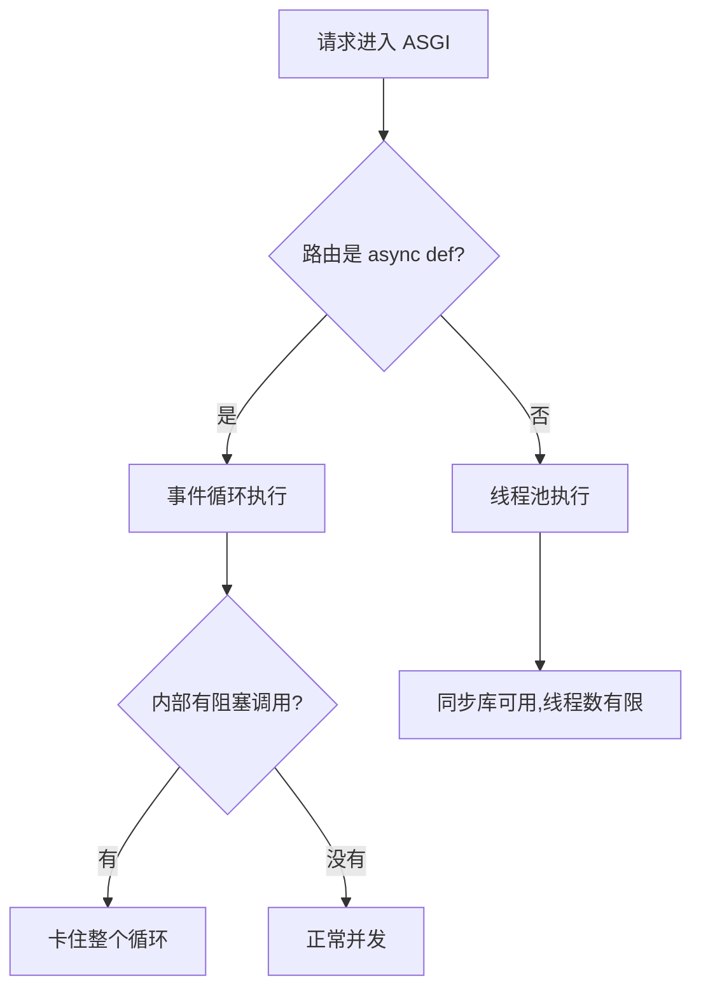

FastAPI 用类型注解同时完成三件事:解析请求参数、校验数据、生成 OpenAPI 文档。它的核心是 Starlette(ASGI 框架)加 Pydantic(数据校验),异步能力来自 ASGI。

## 最小应用

```python
from fastapi import FastAPI
from pydantic import BaseModel

app = FastAPI()

class User(BaseModel):
    name: str
    age: int

@app.get("/users/{user_id}")
def get_user(user_id: int):
    return {"id": user_id, "name": "Ada"}

@app.post("/users", status_code=201)
def create_user(user: User):
    return user
```

运行:

```bash
uvicorn main:app --reload
```

`user_id: int` 让 FastAPI 把路径段转成整数,转换失败自动返回 422;`user: User` 让请求体按模型校验。参数来源由位置与类型决定:

| 位置 | 来源 |
| --- | --- |
| 路径中的 `{name}` | 路径参数 |
| 普通标量参数 | 查询参数 |
| Pydantic 模型参数 | 请求体 JSON |
| `Header`/`Cookie`/`Form` | 对应位置 |

## 校验与响应模型

```python
from pydantic import BaseModel, Field, EmailStr

class UserIn(BaseModel):
    name: str = Field(min_length=1, max_length=50)
    email: EmailStr
    age: int = Field(ge=0, le=150)

class UserOut(BaseModel):
    id: int
    name: str

@app.post("/users", response_model=UserOut)
def create(user: UserIn) -> UserOut:
    ...
```

- 请求模型负责输入校验,`Field` 提供范围与长度约束;
- `response_model` 过滤输出字段,避免把密码哈希、内部字段返回给客户端;
- 校验失败返回 422 与结构化错误详情,不需要手写;
- `EmailStr` 需要安装 `email-validator`。

输出模型与输入模型分开是接口设计的基本功:入参约束与出参暴露是两件事。

## 依赖注入

```python
from fastapi import Depends, HTTPException

def get_db():
    db = SessionLocal()
    try:
        yield db
    finally:
        db.close()

def get_current_user(token: str, db=Depends(get_db)) -> User:
    user = lookup(db, token)
    if not user:
        raise HTTPException(status_code=401, detail="未认证")
    return user

@app.get("/me")
def me(user: User = Depends(get_current_user)):
    return user
```

- `Depends` 把函数作为依赖,自动解析其参数并注入;
- 生成器依赖的 `yield` 之后做清理,与 `contextmanager` 同构;
- 依赖可嵌套(认证依赖数据库),FastAPI 按依赖图执行并缓存同一次请求内的结果;
- 抛 `HTTPException` 直接生成对应状态码与 JSON 错误体。

依赖注入是 FastAPI 最实用的设计:认证、数据库、分页、限流都能写成依赖,路由函数只关心业务。

## 同步与异步

```python
@app.get("/sync")
def sync_route():
    return blocking_io()        # FastAPI 放到线程池执行

@app.get("/async")
async def async_route():
    return await async_io()     # 在事件循环里执行
```

- `def` 路由由 FastAPI 放进线程池,可以安全调用同步库,但线程池容量有限;
- `async def` 路由在事件循环里执行,内部**不能**有阻塞调用,否则卡住整个服务;
- 混用时判断标准:函数内是否 await?不 await 的 CPU 或阻塞 IO 应该放同步路由或用 `to_thread`。



## 错误处理

```python
from fastapi import HTTPException
from fastapi.responses import JSONResponse

@app.exception_handler(ValueError)
async def value_error_handler(request, exc):
    return JSONResponse(status_code=400, content={"detail": str(exc)})
```

业务异常可以统一注册 handler,转成固定错误结构。`HTTPException` 适合"请求本身有问题",未捕获异常默认返回 500,不应把内部堆栈暴露给客户端。

## 自动文档

启动后访问:

- `/docs`:Swagger UI,可直接试调接口;
- `/redoc`:ReDoc 文档;
- `/openapi.json`:OpenAPI 描述,供客户端代码生成。

文档质量取决于模型与注解的完整度。给字段加 `Field(description=...)`、给路由加 `summary`/`tags`,生成的文档才能直接交给前端。

## 项目结构

```text
app/
├── main.py            # 创建 FastAPI 实例,注册路由
├── api/
│   └── users.py       # APIRouter,按资源拆分
├── models.py          # Pydantic 模型
├── db.py              # 数据库与会话
└── deps.py            # 依赖函数
```

路由用 `APIRouter` 分组,`main.py` 只做装配。模型、数据库、依赖分文件放置,避免所有代码堆在一个模块里。

## 常见问题

- **async 路由里调用 requests / 同步 ORM**:阻塞事件循环,吞吐骤降;
- **不设 response_model**:内部字段泄露;
- **在路由里手写 try/except 返回 500**:统一 handler 更可控;
- **依赖里创建全局连接却不关闭**:用 yield 依赖或连接池;
- **把业务逻辑写进路由函数**:难以测试与复用,抽到 service 层;
- **在文档里暴露内部错误细节**:安全风险。

## 小结

- 类型注解同时完成参数解析、校验与文档生成;
- 输入模型与响应模型分开,`response_model` 控制输出;
- `Depends` 承载认证、数据库等横切逻辑,生成器依赖负责清理;
- `def` 路由走线程池,`async def` 路由禁止阻塞调用;
- 统一异常处理与模块化路由是项目化的基础。
