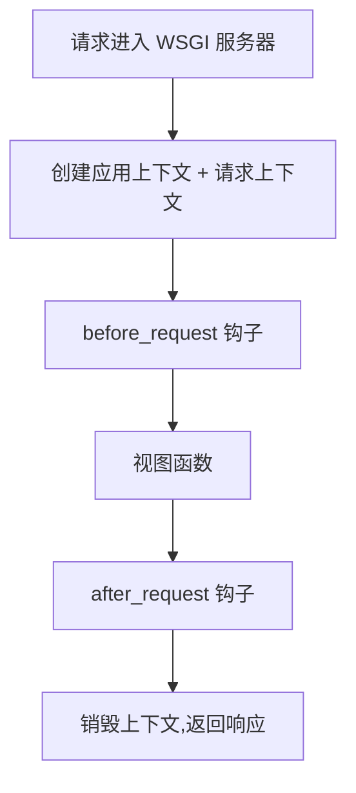

Flask 是"微框架":核心只提供路由、请求响应与模板,数据库、表单、认证都由扩展补。它灵活、生态成熟、上手快,适合中小服务与内部工具。与 FastAPI 的主要差别在数据校验、异步与文档能力上。

## 最小应用

```python
from flask import Flask, request, jsonify

app = Flask(__name__)

@app.get("/users/<int:user_id>")
def get_user(user_id):
    return jsonify({"id": user_id})

@app.post("/users")
def create_user():
    data = request.get_json()
    if not data or "name" not in data:
        return {"error": "name 必填"}, 400
    return {"id": 1, "name": data["name"]}, 201

if __name__ == "__main__":
    app.run(debug=True)
```

- 路由用装饰器声明,`<int:user_id>` 在匹配时转换类型;
- 返回值可以是字符串、dict(自动 JSON)、元组(体, 状态码);
- `request` 是当前请求的代理对象,`get_json()` 解析请求体;
- 生产环境不要用 `app.run`,应交给 gunicorn/uWSGI 等 WSGI 服务器。

## 请求与响应

```python
request.args.get("page", 1, type=int)      # 查询参数
request.headers.get("Authorization")
request.form["name"]                       # 表单
request.files["upload"]                    # 文件
request.method, request.path
```

```python
from flask import make_response

resp = make_response({"ok": True}, 200)
resp.headers["X-Trace"] = "abc"
resp.set_cookie("session", "value", httponly=True, samesite="Lax")
return resp
```

响应头、cookie、状态码都通过响应对象控制。JSON 接口返回 dict 即可,Flask 会自动序列化并设置 `application/json`。

## 蓝图:模块拆分

```python
# users.py
from flask import Blueprint, jsonify

bp = Blueprint("users", __name__, url_prefix="/users")

@bp.get("/<int:user_id>")
def get_user(user_id):
    return jsonify({"id": user_id})

# app.py
from flask import Flask
from users import bp

app = Flask(__name__)
app.register_blueprint(bp)
```

蓝图把一组路由收在一个模块里,带统一前缀,应用只负责注册。大型项目按资源拆蓝图,与 FastAPI 的 `APIRouter` 是同一思路。

## 上下文

Flask 用上下文变量把 `request`、`session`、`g`、`current_app` 绑定到当前请求:

```python
from flask import g, current_app

@app.before_request
def load_user():
    g.user = lookup_user(request.headers.get("Authorization"))

@app.get("/me")
def me():
    return {"user": g.user.name}
```



`g` 是请求级临时存储,请求结束即销毁;`current_app` 指向应用配置。上下文机制让扩展能在不传参的情况下拿到请求,但也会让"隐式依赖"变多,测试时要显式构造上下文。

## WSGI 与 ASGI

Flask 是 WSGI 框架:请求同步处理,一个工作进程一次处理一个请求。并发靠多进程/多线程的 WSGI 服务器(如 gunicorn 的 sync/threads worker)。

FastAPI 是 ASGI 框架:支持异步与长连接(WebSocket),单个进程可以同时处理大量 IO 等待。

| | Flask | FastAPI |
| --- | --- | --- |
| 协议 | WSGI(同步) | ASGI(异步) |
| 数据校验 | 手动或扩展 | Pydantic 内建 |
| 文档 | 需扩展 | 自动 OpenAPI |
| 异步 | 有限支持 | 原生 |
| 生态 | 扩展丰富、成熟 | 较新但增长快 |
| 适合 | 传统 Web、内部工具、小服务 | API 服务、高并发 IO |

Flask 3.x 也支持 `async def` 视图,但底层仍受 WSGI 模型限制,不要把它当异步框架使用。

## 选型建议

- 已有 Flask 项目、团队熟悉其扩展生态:继续用,不必为了异步重写;
- 新项目以 JSON API 为主、需要校验与文档:FastAPI 更省事;
- 需要服务端渲染的传统站点:Flask + Jinja2 足够;
- 高并发长连接、WebSocket:选 ASGI 体系;
- 内部工具与脚本化服务:Flask 的轻量优势明显。

框架不是能力上限,业务复杂度最终还是落在项目结构与团队约定上。

## 常见问题

- **生产用 `app.run`**:单线程开发服务器,不能承载并发;
- **`debug=True` 进生产**:暴露调试器,可执行任意代码;
- **全局可变状态**:多进程/多线程下互相污染,用 `g` 或外部存储;
- **在视图里用 `request` 之外的地方访问上下文**:后台线程拿不到请求上下文;
- **异常直接抛出**:默认 500 页面可能暴露细节,注册 errorhandler 统一处理;
- **蓝图循环导入**:路由模块不要反向导入 app,通过 `current_app` 取配置。

## 小结

- Flask 是微框架,路由、请求与模板在核心,其余靠扩展;
- `request`/`g`/`current_app` 由上下文提供,生命周期跟随请求;
- 蓝图负责模块化,应用只做注册;
- WSGI 同步模型靠多进程/线程扩展并发,ASGI 原生异步;
- 选型看校验需求、异步需求与团队生态,而非单纯性能数字。
