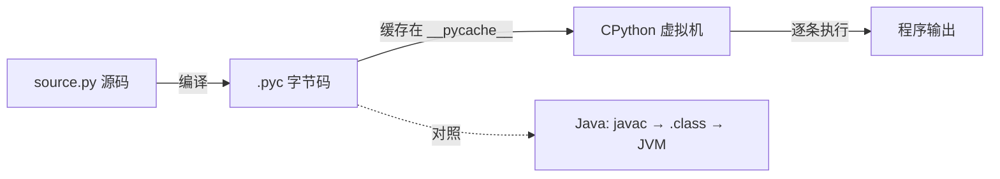

Python 是一门动态类型、解释执行的通用编程语言。它的设计取向是**可读性优先**:用缩进划分代码块、用接近英语的关键词表达逻辑,把"写清楚"放在"写简短"之前。这一篇先弄清它怎么运行、版本怎么选、生态长什么样。

## 解释执行,但并非没有编译

常有人说"Python 是解释型语言,不编译"。准确的说法是:CPython(官方实现)先把源码编译成**字节码**(.pyc,缓存在 `__pycache__`),再由虚拟机逐条执行字节码。编译这一步对使用者透明,不需要手动触发,所以观感上是"写完直接跑"。

与 Java 的对照:Java 源码编译成 .class 字节码交给 JVM;Python 源码编译成字节码交给 CPython 虚拟机。两者都有字节码层,差别在于 Java 把编译暴露为独立步骤(javac),Python 把它藏进运行时。

## 动态类型

变量不需要声明类型,类型属于**对象**而非名字:同一个名字可以先绑定整数再绑定字符串。类型检查发生在运行时,写错类型要到执行那一行才报错。这带来灵活,也带来"错误后移"的代价——第 8 章的类型提示与静态检查就是为把部分错误提前到编写期。

## 版本:只学 3.x

- Python 2 已于 2020-01-01 停止维护,新项目一律 3.x;
- 3.x 每年发布一个_minor 版本(3.12、3.13、3.14…),每个版本约五年支持(前两年完整修复,后三年仅安全修复);
- 语法在 3.x 内部基本向后兼容,但**不保证跨 minor 完全兼容**(如 3.12 移除 distutils);
- 本知识库以 **3.12+** 为基准,涉及新语法会标注起始版本。

查看本机版本:`python --version`(Windows)或 `python3 --version`(macOS/Linux)。

## 生态:PyPI 与标准库

- **标准库**:随解释器附带,文件、网络、正则、日期、并发、测试都有覆盖,"batteries included";
- **PyPI**(pypi.org):第三方包仓库,pip 安装。数据方向的 numpy/pandas、Web 方向的 FastAPI/Flask/Django、AI 方向的 PyTorch/Transformers 都在其上;
- **实现**:CPython 是默认;PyPy 带 JIT 提速;另有 Jython/IronPython 等历史实现,生产少见。

## 适用与不适用

适合:脚本与自动化、数据处理与分析、Web 后端、AI/机器学习、教学与原型。
不擅长:CPU 密集的单线程计算(受 GIL 与解释开销限制,第 10、14 章讲对策)、移动端与浏览器原生运行、对延迟极硬的实时系统。

注意:「解释型所以慢」是过度简化。IO 密集场景瓶颈在网络与磁盘,语言开销占比小;CPU 密集可用 numpy 向量化、多进程或换运行时弥补。

## 小结

- CPython 先编译字节码再虚拟机执行,编译对使用者透明;
- 动态类型:类型在对象上,检查在运行时;
- 只学 3.x,每年一个 minor、约五年支持,本库基准 3.12+;
- 标准库 + PyPI 构成生态;CPython 为默认实现;
- 擅长脚本/数据/Web/AI,CPU 密集单线程是短板,有对策。

下一篇把环境装起来,跑出第一个程序。
